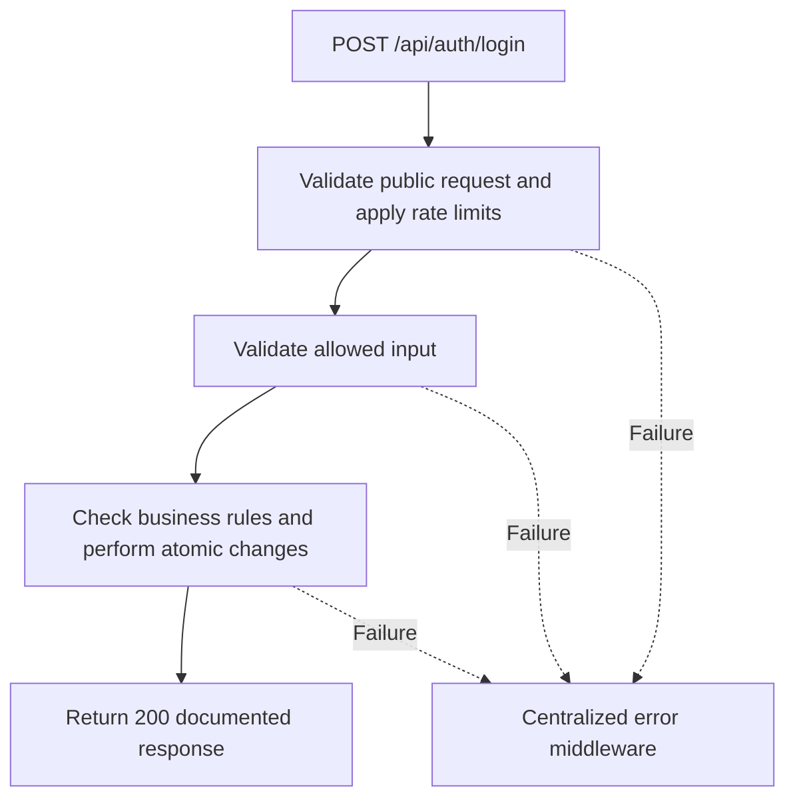

# Task BE-004: Staff login

**Endpoint**: `POST /api/auth/login`

**Owner**: Member 1 · **Priority**: Must · **Requirement**: FR-AUTH-01/02/03

**Dependencies**: BE-001, BE-002, BE-003. Dependencies describe contracts and integration order; use fixtures to begin development before the corresponding endpoint is complete.

## 1. API Documentation

- **Method**: `POST`
- **URL**: `/api/auth/login`
- **Access**: Public
- **Authentication**: `None`
- **Content-Type**: `application/json`

### Request body

```json
{
  "email": "manager@abegarage.com",
  "password": "StrongPassword123!"
}
```

### Success response (200)

```json
{
  "status": "success",
  "message": "Staff login successful",
  "data": {
    "access_token": "<application-jwt>",
    "token_type": "Bearer",
    "expires_in": 3600,
    "employee": {
      "employee_id": 2,
      "first_name": "Abebe",
      "last_name": "Kebede",
      "email": "abebe@abegarage.com",
      "phone": "0911234567",
      "role_id": 2,
      "role_name": "Manager",
      "active": true,
      "created_at": "2026-10-25T12:00:00Z"
    }
  }
}
```

Examples use representative fixture records. Responses may have more/fewer array elements; fields and types are contractual. Nullable fields remain present as null. Where a task documents a restricted role projection, that projection replaces the general example for that role.

### Errors

- 400 Invalid input (unless this task specifies a different public-token rule)
- 401 Invalid email or password
- 403 Account disabled
- 429 Too many attempts
- 500 Unexpected server error

Shared error format (field errors apply to validation failures):

```json
{
  "status": "error",
  "message": "Validation failed",
  "data": {
    "errors": {
      "email": "Enter a valid email address"
    }
  }
}
```

Non-validation errors use `data: null`, except explicitly documented safe metadata. See [shared conventions](../CONVENTIONS.md).

## 2. Instructions

1. Define route and middleware in `backend/src/api/auth/routes/auth.route.js`.
2. Add `loginValidation` in `backend/src/api/auth/validations/auth.validation.js`.
3. Implement `loginController` in `backend/src/api/auth/controller/auth.controller.js`. Extract allowlisted inputs and verified actor context only.
4. Implement `loginService` in `backend/src/api/auth/service/auth.service.js`. Keep business rules and SQL out of controllers.
5. Share transactions, money/status helpers and notification adapter as described in foundation tasks; do not duplicate other modules’ logic.
6. On errors call `next(error)` from controller catches or use the shared async wrapper. Do not send competing error formats.

## 3. Logic & Git Instructions

### Logic steps

1. Validate email and password; trim/lowercase email. Do not trim or silently modify passwords.
2. Look up employee; compare bcrypt hash. Unknown email and wrong password both yield 401 with Invalid email or password. Use a dummy bcrypt comparison for unknown accounts to reduce timing differences.
3. After credentials match, reject inactive employee with 403 Account disabled.
4. Issue access JWT containing employee_id, token_version, token_use=access, iat and exp; use JWT_EXPIRES_IN_SECONDS (default 3600). Middleware allowlists signing algorithm and verifies issuer/audience.
5. Return safe employee fields and access_token. Rate-limit attempts by IP and normalized account identifier; never log credentials or tokens.

### Git workflow

```bash
git checkout dev
git pull --ff-only origin dev
git checkout -b codex/be-004-login
# Implement and run task-specific checks
git add <changed-files>
git commit -m "[BE-004] Staff login"
git push -u origin codex/be-004-login
```

Open a PR into dev with requirement IDs, examples and test evidence. One teammate reviews. Coordinate shared route registration through Member 1; module files belong to their listed owner.

### PR checklist and acceptance criteria

- [ ] Successful request returns 200 and exactly the documented safe response shape.
- [ ] Works without staff login; applies documented rate limits and public-field restrictions.
- [ ] Verify 401 Invalid email or password.
- [ ] Verify 403 Account disabled.
- [ ] Verify 429 Too many attempts.
- [ ] Invalid/unknown input fields are rejected; no unexpected database changes occur on failure.
- [ ] Transaction/concurrency behavior and repeated-request behavior match the logic below.
- [ ] All errors go through centralized error middleware; no sensitive fields or stack traces escape.

## 4. Logic Diagram


