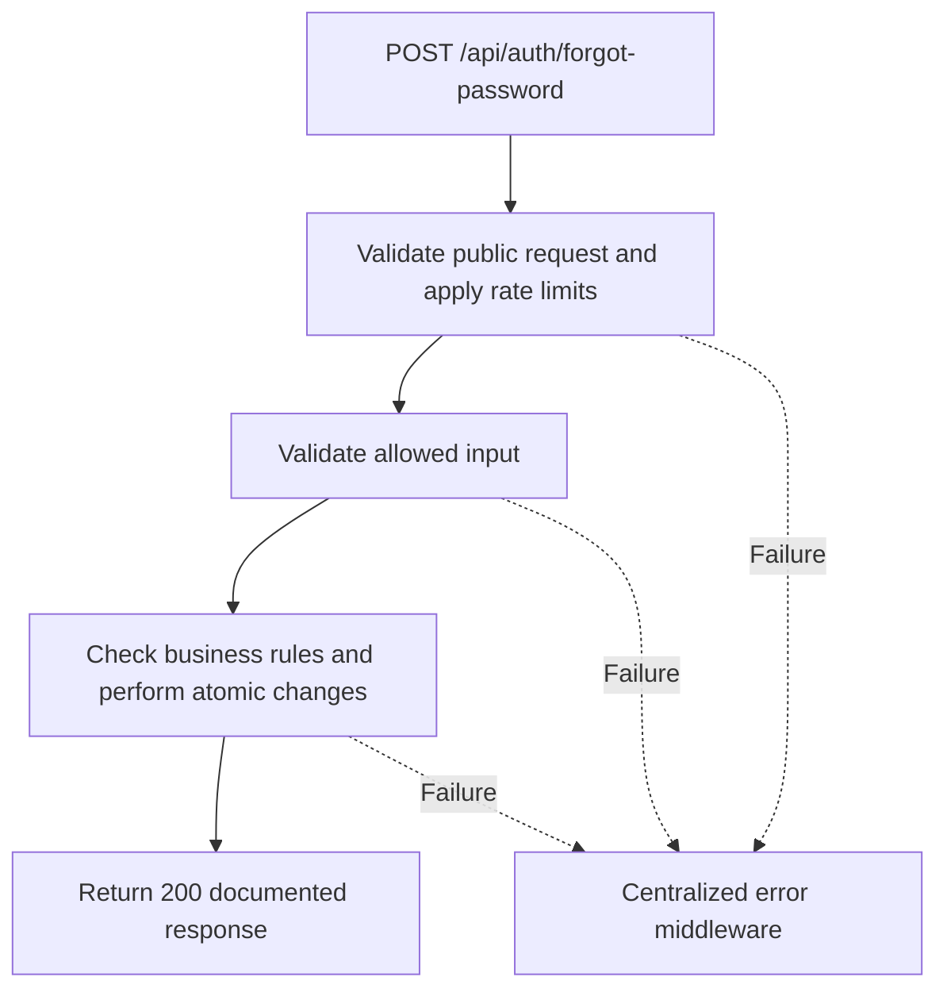

# Task BE-005: Request password reset

**Endpoint**: `POST /api/auth/forgot-password`

**Owner**: Member 1 · **Priority**: Must (agreed addition) · **Requirement**: AUTH extension

**Dependencies**: BE-003, BE-043. Dependencies describe contracts and integration order; use fixtures to begin development before the corresponding endpoint is complete.

## 1. API Documentation

- **Method**: `POST`
- **URL**: `/api/auth/forgot-password`
- **Access**: Public
- **Authentication**: `None`
- **Content-Type**: `application/json`

### Request body

```json
{
  "email": "abebe@abegarage.com"
}
```

### Success response (200)

```json
{
  "status": "success",
  "message": "If an eligible account exists, a password reset link will be sent.",
  "data": null
}
```

Examples use representative fixture records. Responses may have more/fewer array elements; fields and types are contractual. Nullable fields remain present as null. Where a task documents a restricted role projection, that projection replaces the general example for that role.

### Errors

- 400 Invalid input (unless this task specifies a different public-token rule)
- 400 Invalid email format
- 429 Too many attempts
- 500 Unexpected server error

Shared error format (field errors apply to validation failures):

```json
{
  "status": "error",
  "message": "Validation failed",
  "data": {
    "errors": {
      "email": "Enter a valid email address"
    }
  }
}
```

Non-validation errors use `data: null`, except explicitly documented safe metadata. See [shared conventions](../CONVENTIONS.md).

## 2. Instructions

1. Define route and middleware in `backend/src/api/auth/routes/auth.route.js`.
2. Add `forgotPasswordValidation` in `backend/src/api/auth/validations/auth.validation.js`.
3. Implement `forgotPasswordController` in `backend/src/api/auth/controller/auth.controller.js`. Extract allowlisted inputs and verified actor context only.
4. Implement `forgotPasswordService` in `backend/src/api/auth/service/auth.service.js`. Keep business rules and SQL out of controllers.
5. Share transactions, money/status helpers and notification adapter as described in foundation tasks; do not duplicate other modules’ logic.
6. On errors call `next(error)` from controller catches or use the shared async wrapper. Do not send competing error formats.

## 3. Logic & Git Instructions

### Logic steps

1. Validate and normalize email. Always return the exact same 200 message for eligible, missing and inactive accounts: If an eligible account exists, a password reset link will be sent.
2. For active staff generate crypto.randomBytes(32).toString("hex"); store only its SHA-256 hex digest with a 15-minute UTC expiry.
3. Serialize issuance per employee in a transaction: invalidate outstanding tokens, insert new token. Send only after commit through the shared mail adapter. Build the link from configured FRONTEND_URL, never the request Host header.
4. Send /reset-password?token=<raw-token> by email, never in this API response. Handle delivery failure internally with sanitized logs and a retryable user action; preserve the generic response. Do not store raw tokens in logs.
5. Rate-limit by account and IP; align response timing for account eligibility outcomes. Do not alter the employee password or token_version at this stage.

### Git workflow

```bash
git checkout dev
git pull --ff-only origin dev
git checkout -b codex/be-005-forgot-password
# Implement and run task-specific checks
git add <changed-files>
git commit -m "[BE-005] Request password reset"
git push -u origin codex/be-005-forgot-password
```

Open a PR into dev with requirement IDs, examples and test evidence. One teammate reviews. Coordinate shared route registration through Member 1; module files belong to their listed owner.

### PR checklist and acceptance criteria

- [ ] Successful request returns 200 and exactly the documented safe response shape.
- [ ] Works without staff login; applies documented rate limits and public-field restrictions.
- [ ] Verify 400 Invalid email format.
- [ ] Verify 429 Too many attempts.
- [ ] Invalid/unknown input fields are rejected; no unexpected database changes occur on failure.
- [ ] Transaction/concurrency behavior and repeated-request behavior match the logic below.
- [ ] All errors go through centralized error middleware; no sensitive fields or stack traces escape.

## 4. Logic Diagram


