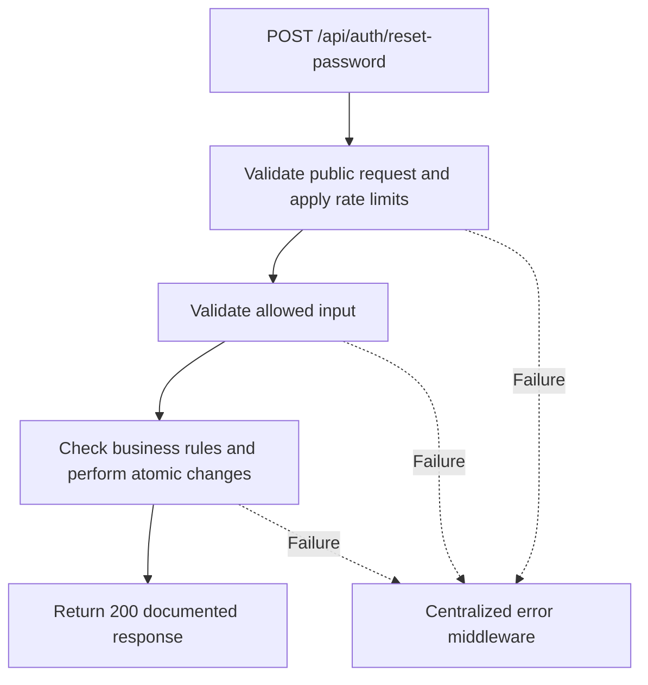

# Task BE-006: Reset forgotten password

**Endpoint**: `POST /api/auth/reset-password`

**Owner**: Member 1 · **Priority**: Must (agreed addition) · **Requirement**: AUTH extension

**Dependencies**: BE-005. Dependencies describe contracts and integration order; use fixtures to begin development before the corresponding endpoint is complete.

## 1. API Documentation

- **Method**: `POST`
- **URL**: `/api/auth/reset-password`
- **Access**: Public
- **Authentication**: `None`
- **Content-Type**: `application/json`

### Request body

```json
{
  "token": "<64-character-hex-reset-token>",
  "new_password": "NewStrongPassword123!"
}
```

### Success response (200)

```json
{
  "status": "success",
  "message": "Password reset successfully. Please log in.",
  "data": null
}
```

Examples use representative fixture records. Responses may have more/fewer array elements; fields and types are contractual. Nullable fields remain present as null. Where a task documents a restricted role projection, that projection replaces the general example for that role.

### Errors

- 400 Invalid input (unless this task specifies a different public-token rule)
- 400 Invalid or expired reset link
- 429 Too many attempts
- 500 Unexpected server error

Shared error format (field errors apply to validation failures):

```json
{
  "status": "error",
  "message": "Validation failed",
  "data": {
    "errors": {
      "email": "Enter a valid email address"
    }
  }
}
```

Non-validation errors use `data: null`, except explicitly documented safe metadata. See [shared conventions](../CONVENTIONS.md).

## 2. Instructions

1. Define route and middleware in `backend/src/api/auth/routes/auth.route.js`.
2. Add `resetPasswordValidation` in `backend/src/api/auth/validations/auth.validation.js`.
3. Implement `resetPasswordController` in `backend/src/api/auth/controller/auth.controller.js`. Extract allowlisted inputs and verified actor context only.
4. Implement `resetPasswordService` in `backend/src/api/auth/service/auth.service.js`. Keep business rules and SQL out of controllers.
5. Share transactions, money/status helpers and notification adapter as described in foundation tasks; do not duplicate other modules’ logic.
6. On errors call `next(error)` from controller catches or use the shared async wrapper. Do not send competing error formats.

## 3. Logic & Git Instructions

### Logic steps

1. Validate token format and password (8 to 72 UTF-8 bytes for bcrypt). Hash the supplied token with SHA-256.
2. Use one pooled connection and transaction. Resolve candidate token, lock its employee row first, then lock token row; recheck all eligibility after locking. Use the same lock order as issuance and password change.
3. Missing, used, expired tokens and inactive employees all return 400 Invalid or expired reset link. The token is not an access JWT and cannot authenticate staff APIs.
4. Update password_hash using bcrypt; increment token_version; mark every outstanding reset token for the employee used; commit atomically.
5. Do not log the user in automatically. Frontend returns to login. Rate-limit reset attempts.

### Git workflow

```bash
git checkout dev
git pull --ff-only origin dev
git checkout -b codex/be-006-reset-password
# Implement and run task-specific checks
git add <changed-files>
git commit -m "[BE-006] Reset forgotten password"
git push -u origin codex/be-006-reset-password
```

Open a PR into dev with requirement IDs, examples and test evidence. One teammate reviews. Coordinate shared route registration through Member 1; module files belong to their listed owner.

### PR checklist and acceptance criteria

- [ ] Successful request returns 200 and exactly the documented safe response shape.
- [ ] Works without staff login; applies documented rate limits and public-field restrictions.
- [ ] Verify 400 Invalid or expired reset link.
- [ ] Verify 429 Too many attempts.
- [ ] Invalid/unknown input fields are rejected; no unexpected database changes occur on failure.
- [ ] Transaction/concurrency behavior and repeated-request behavior match the logic below.
- [ ] All errors go through centralized error middleware; no sensitive fields or stack traces escape.

## 4. Logic Diagram


