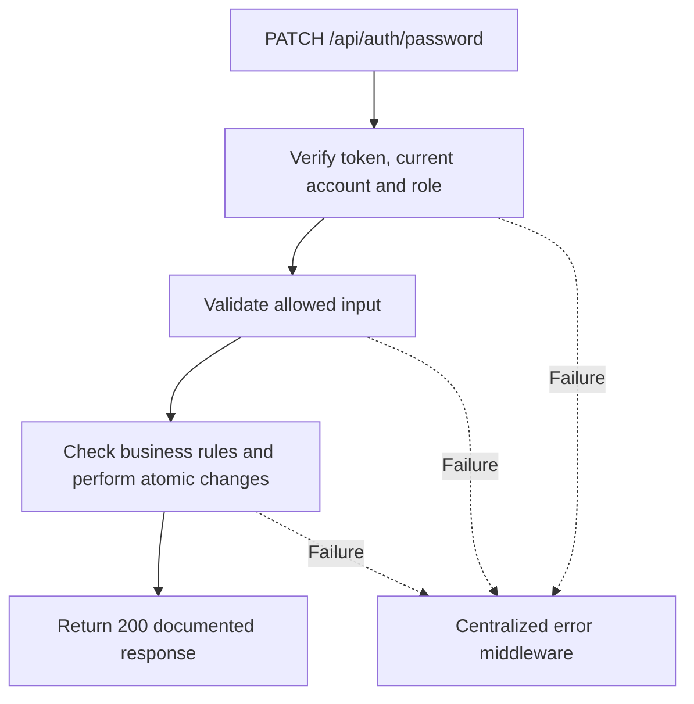

# Task BE-007: Change own password

**Endpoint**: `PATCH /api/auth/password`

**Owner**: Member 1 · **Priority**: Should · **Requirement**: FR-AUTH-07

**Dependencies**: BE-003, BE-004. Dependencies describe contracts and integration order; use fixtures to begin development before the corresponding endpoint is complete.

## 1. API Documentation

- **Method**: `PATCH`
- **URL**: `/api/auth/password`
- **Access**: Any active staff
- **Authentication**: `Authorization: Bearer <access_token>`
- **Content-Type**: `application/json`

### Request body

```json
{
  "current_password": "StrongPassword123!",
  "new_password": "AnotherStrongPassword123!"
}
```

### Success response (200)

```json
{
  "status": "success",
  "message": "Password changed successfully. Please log in again.",
  "data": null
}
```

Examples use representative fixture records. Responses may have more/fewer array elements; fields and types are contractual. Nullable fields remain present as null. Where a task documents a restricted role projection, that projection replaces the general example for that role.

### Errors

- 400 Invalid input (unless this task specifies a different public-token rule)
- 401 Missing, invalid, expired or revoked access token
- 403 Inactive account or insufficient role
- 400 Current password is incorrect
- 500 Unexpected server error

Shared error format (field errors apply to validation failures):

```json
{
  "status": "error",
  "message": "Validation failed",
  "data": {
    "errors": {
      "email": "Enter a valid email address"
    }
  }
}
```

Non-validation errors use `data: null`, except explicitly documented safe metadata. See [shared conventions](../CONVENTIONS.md).

## 2. Instructions

1. Define route and middleware in `backend/src/api/auth/routes/auth.route.js`.
2. Add `changePasswordValidation` in `backend/src/api/auth/validations/auth.validation.js`.
3. Implement `changePasswordController` in `backend/src/api/auth/controller/auth.controller.js`. Extract allowlisted inputs and verified actor context only.
4. Implement `changePasswordService` in `backend/src/api/auth/service/auth.service.js`. Keep business rules and SQL out of controllers.
5. Share transactions, money/status helpers and notification adapter as described in foundation tasks; do not duplicate other modules’ logic.
6. On errors call `next(error)` from controller catches or use the shared async wrapper. Do not send competing error formats.

## 3. Logic & Git Instructions

### Logic steps

1. Take employee_id only from verified authentication context, not from request body. Validate both password fields.
2. Verify current password; mismatch returns 400 Current password is incorrect.
3. Within one transaction lock employee, recheck current password and active flag, update bcrypt hash, increment token_version, invalidate outstanding reset tokens.
4. Return 200 Password changed successfully. Please log in again. The current JWT and every other access JWT are invalid on their next request; clear local session after success.

### Git workflow

```bash
git checkout dev
git pull --ff-only origin dev
git checkout -b codex/be-007-change-password
# Implement and run task-specific checks
git add <changed-files>
git commit -m "[BE-007] Change own password"
git push -u origin codex/be-007-change-password
```

Open a PR into dev with requirement IDs, examples and test evidence. One teammate reviews. Coordinate shared route registration through Member 1; module files belong to their listed owner.

### PR checklist and acceptance criteria

- [ ] Successful request returns 200 and exactly the documented safe response shape.
- [ ] Missing/expired/revoked token returns401; inactive account and unauthorized role return403.
- [ ] Verify 400 Current password is incorrect.
- [ ] Invalid/unknown input fields are rejected; no unexpected database changes occur on failure.
- [ ] Transaction/concurrency behavior and repeated-request behavior match the logic below.
- [ ] All errors go through centralized error middleware; no sensitive fields or stack traces escape.

## 4. Logic Diagram


