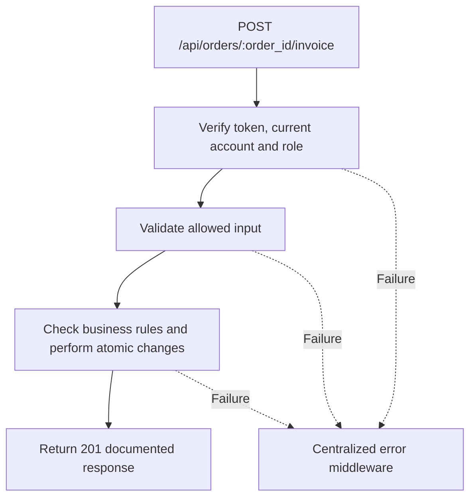

# Task BE-040: Issue immutable invoice

**Endpoint**: `POST /api/orders/:order_id/invoice`

**Owner**: Member 4 · **Priority**: Must (supporting endpoint) · **Requirement**: FR-INV-01/03/05

**Dependencies**: BE-037, BE-039. Dependencies describe contracts and integration order; use fixtures to begin development before the corresponding endpoint is complete.

## 1. API Documentation

- **Method**: `POST`
- **URL**: `/api/orders/:order_id/invoice`
- **Access**: Manager or Admin
- **Authentication**: `Authorization: Bearer <access_token>`
- **Content-Type**: `application/json`
- **Path parameters**: `order_id` (positive integer)

### Request body

None. Do not send a JSON body.

### Success response (201)

```json
{
  "status": "success",
  "message": "Issue immutable invoice successful",
  "data": {
    "order_id": 24,
    "document_type": "invoice",
    "issued_at": "2026-10-25T12:00:00Z",
    "garage": {
      "settings_id": 1,
      "name": "Abe Garage",
      "address": "Addis Ababa",
      "phone": "0111234567",
      "email": "contact@abegarage.com",
      "vat_rate": "15.00"
    },
    "customer": {
      "first_name": "Sara",
      "last_name": "Tesfaye",
      "email": "sara@example.com",
      "phone": "0912345678"
    },
    "vehicle": {
      "vehicle_id": 8,
      "customer_id": 12,
      "year": 2020,
      "make": "Toyota",
      "model": "Corolla",
      "type": "Sedan",
      "mileage": 65000,
      "plate": "AA-12345",
      "vin": "JTDBR32E720123456",
      "color": "White"
    },
    "lines": [
      {
        "line_id": 41,
        "service_name": "Oil change",
        "description": "Replace engine oil and filter",
        "line_price": "50.00"
      },
      {
        "line_id": 42,
        "service_name": "Brake service",
        "description": "Inspect and service brakes",
        "line_price": "180.00"
      }
    ],
    "subtotal": "230.00",
    "vat_rate": "15.00",
    "vat_amount": "34.50",
    "total": "264.50",
    "currency": "ETB",
    "status": 4,
    "invoice_number": "INV-000024",
    "paid": false,
    "paid_at": null,
    "paid_received_by": null
  }
}
```

Examples use representative fixture records. Responses may have more/fewer array elements; fields and types are contractual. Nullable fields remain present as null. Where a task documents a restricted role projection, that projection replaces the general example for that role.

### Errors

- 400 Invalid input (unless this task specifies a different public-token rule)
- 401 Missing, invalid, expired or revoked access token
- 403 Inactive account or insufficient role
- 404 Order not found
- 409 Only completed orders can be invoiced
- 500 Unexpected server error

Shared error format (field errors apply to validation failures):

```json
{
  "status": "error",
  "message": "Validation failed",
  "data": {
    "errors": {
      "email": "Enter a valid email address"
    }
  }
}
```

Non-validation errors use `data: null`, except explicitly documented safe metadata. See [shared conventions](../CONVENTIONS.md).

## 2. Instructions

1. Define route and middleware in `backend/src/api/billing/routes/billing.route.js`.
2. Add `issueInvoiceValidation` in `backend/src/api/billing/validations/billing.validation.js`.
3. Implement `issueInvoiceController` in `backend/src/api/billing/controller/billing.controller.js`. Extract allowlisted inputs and verified actor context only.
4. Implement `issueInvoiceService` in `backend/src/api/billing/service/billing.service.js`. Keep business rules and SQL out of controllers.
5. Share transactions, money/status helpers and notification adapter as described in foundation tasks; do not duplicate other modules’ logic.
6. On errors call `next(error)` from controller catches or use the shared async wrapper. Do not send competing error formats.

## 3. Logic & Git Instructions

### Logic steps

1. Lock order and verify status4 and every line done. Declined/unfinished orders return409. Invoice creation is a write operation, so use POST, not GET.
2. If already issued return existing invoice with200, without new number or new snapshot. First issue returns201. Deterministic unique invoice_number=INV- plus zero-padded order_id avoids a shared number counter.
3. Persist invoice_number,invoice_issued_at,invoice_snapshot together. Snapshot includes garage details,customer/vehicle fields,line descriptions/prices,currency,vat_rate and totals, all from stored order values.
4. After issuance, prevent line/price/financial identity edits. Payment status is live metadata outside immutable invoice_snapshot. Browser renders JSON into A4/PDF; no PDF generation endpoint required.
5. Use source row locks or a consistent transaction read when capturing snapshot. Invoice issuance must not change order status or mark it paid.

### Git workflow

```bash
git checkout dev
git pull --ff-only origin dev
git checkout -b codex/be-040-issue-invoice
# Implement and run task-specific checks
git add <changed-files>
git commit -m "[BE-040] Issue immutable invoice"
git push -u origin codex/be-040-issue-invoice
```

Open a PR into dev with requirement IDs, examples and test evidence. One teammate reviews. Coordinate shared route registration through Member 1; module files belong to their listed owner.

### PR checklist and acceptance criteria

- [ ] Successful request returns 201 and exactly the documented safe response shape.
- [ ] Repeat issuance returns200 with identical invoice_number,issued_at and snapshot.
- [ ] Missing/expired/revoked token returns401; inactive account and unauthorized role return403.
- [ ] Verify 404 Order not found.
- [ ] Verify 409 Only completed orders can be invoiced.
- [ ] Invalid/unknown input fields are rejected; no unexpected database changes occur on failure.
- [ ] Transaction/concurrency behavior and repeated-request behavior match the logic below.
- [ ] All errors go through centralized error middleware; no sensitive fields or stack traces escape.

## 4. Logic Diagram


