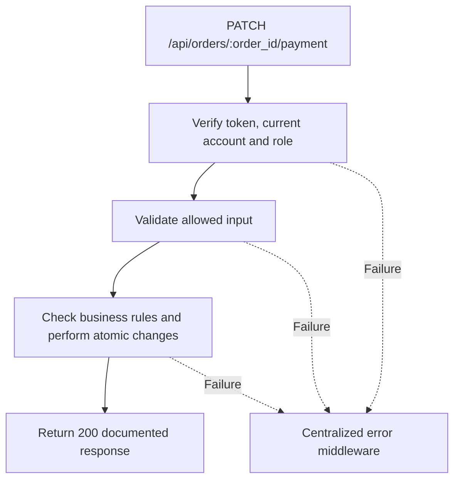

# Task BE-042: Record cash payment

**Endpoint**: `PATCH /api/orders/:order_id/payment`

**Owner**: Member 4 · **Priority**: Must · **Requirement**: FR-INV-02/04

**Dependencies**: BE-040. Dependencies describe contracts and integration order; use fixtures to begin development before the corresponding endpoint is complete.

## 1. API Documentation

- **Method**: `PATCH`
- **URL**: `/api/orders/:order_id/payment`
- **Access**: Manager or Admin
- **Authentication**: `Authorization: Bearer <access_token>`
- **Content-Type**: `application/json`
- **Path parameters**: `order_id` (positive integer)

### Request body

```json
{
  "paid": true
}
```

### Success response (200)

```json
{
  "status": "success",
  "message": "Record cash payment successful",
  "data": {
    "order_id": 24,
    "invoice_number": "INV-000024",
    "paid": true,
    "paid_at": "2026-10-25T12:00:00Z",
    "paid_received_by": 2,
    "total": "264.50",
    "currency": "ETB"
  }
}
```

Examples use representative fixture records. Responses may have more/fewer array elements; fields and types are contractual. Nullable fields remain present as null. Where a task documents a restricted role projection, that projection replaces the general example for that role.

### Errors

- 400 Invalid input (unless this task specifies a different public-token rule)
- 401 Missing, invalid, expired or revoked access token
- 403 Inactive account or insufficient role
- 404 Order not found
- 409 Complete order and issue invoice before payment
- 500 Unexpected server error

Shared error format (field errors apply to validation failures):

```json
{
  "status": "error",
  "message": "Validation failed",
  "data": {
    "errors": {
      "email": "Enter a valid email address"
    }
  }
}
```

Non-validation errors use `data: null`, except explicitly documented safe metadata. See [shared conventions](../CONVENTIONS.md).

## 2. Instructions

1. Define route and middleware in `backend/src/api/billing/routes/billing.route.js`.
2. Add `recordCashPaymentValidation` in `backend/src/api/billing/validations/billing.validation.js`.
3. Implement `recordCashPaymentController` in `backend/src/api/billing/controller/billing.controller.js`. Extract allowlisted inputs and verified actor context only.
4. Implement `recordCashPaymentService` in `backend/src/api/billing/service/billing.service.js`. Keep business rules and SQL out of controllers.
5. Share transactions, money/status helpers and notification adapter as described in foundation tasks; do not duplicate other modules’ logic.
6. On errors call `next(error)` from controller catches or use the shared async wrapper. Do not send competing error formats.

## 3. Logic & Git Instructions

### Logic steps

1. Only accepted body is paid=true. No partial payment,refund,paid=false,payment method,client amount or client timestamp is supported.
2. Lock order and require completed status plus issued invoice. Mark paid_at and paid_received_by from server context; increment no other balances.
3. If already paid return existing payment data200 without changing collector,time or duplicating history. Transaction protects against simultaneous requests.
4. Money dashboards sum paid order totals and paid_at, never invoice issue time or order creation time.

### Git workflow

```bash
git checkout dev
git pull --ff-only origin dev
git checkout -b codex/be-042-record-cash-payment
# Implement and run task-specific checks
git add <changed-files>
git commit -m "[BE-042] Record cash payment"
git push -u origin codex/be-042-record-cash-payment
```

Open a PR into dev with requirement IDs, examples and test evidence. One teammate reviews. Coordinate shared route registration through Member 1; module files belong to their listed owner.

### PR checklist and acceptance criteria

- [ ] Successful request returns 200 and exactly the documented safe response shape.
- [ ] Missing/expired/revoked token returns401; inactive account and unauthorized role return403.
- [ ] Verify 404 Order not found.
- [ ] Verify 409 Complete order and issue invoice before payment.
- [ ] Invalid/unknown input fields are rejected; no unexpected database changes occur on failure.
- [ ] Transaction/concurrency behavior and repeated-request behavior match the logic below.
- [ ] All errors go through centralized error middleware; no sensitive fields or stack traces escape.

## 4. Logic Diagram


