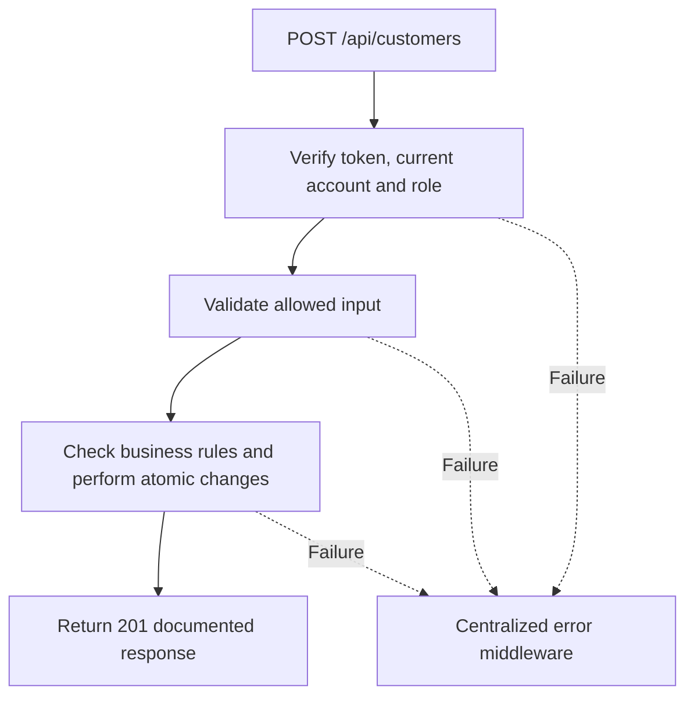

# Task BE-016: Register customer

**Endpoint**: `POST /api/customers`

**Owner**: Member 2 · **Priority**: Must · **Requirement**: FR-CUS-01/02

**Dependencies**: BE-003. Dependencies describe contracts and integration order; use fixtures to begin development before the corresponding endpoint is complete.

## 1. API Documentation

- **Method**: `POST`
- **URL**: `/api/customers`
- **Access**: Manager or Admin
- **Authentication**: `Authorization: Bearer <access_token>`
- **Content-Type**: `application/json`

### Request body

```json
{
  "first_name": "Sara",
  "last_name": "Tesfaye",
  "email": "sara@example.com",
  "phone": "0912345678",
  "active": true
}
```

### Success response (201)

```json
{
  "status": "success",
  "message": "Register customer successful",
  "data": {
    "customer_id": 12,
    "first_name": "Sara",
    "last_name": "Tesfaye",
    "email": "sara@example.com",
    "phone": "0912345678",
    "active": true,
    "created_at": "2026-10-25T12:00:00Z"
  }
}
```

Examples use representative fixture records. Responses may have more/fewer array elements; fields and types are contractual. Nullable fields remain present as null. Where a task documents a restricted role projection, that projection replaces the general example for that role.

### Errors

- 400 Invalid input (unless this task specifies a different public-token rule)
- 401 Missing, invalid, expired or revoked access token
- 403 Inactive account or insufficient role
- 409 Customer email or phone already used
- 500 Unexpected server error

Shared error format (field errors apply to validation failures):

```json
{
  "status": "error",
  "message": "Validation failed",
  "data": {
    "errors": {
      "email": "Enter a valid email address"
    }
  }
}
```

Non-validation errors use `data: null`, except explicitly documented safe metadata. See [shared conventions](../CONVENTIONS.md).

## 2. Instructions

1. Define route and middleware in `backend/src/api/customers/routes/customer.route.js`.
2. Add `createCustomerValidation` in `backend/src/api/customers/validations/customer.validation.js`.
3. Implement `createCustomerController` in `backend/src/api/customers/controller/customer.controller.js`. Extract allowlisted inputs and verified actor context only.
4. Implement `createCustomerService` in `backend/src/api/customers/service/customer.service.js`. Keep business rules and SQL out of controllers.
5. Share transactions, money/status helpers and notification adapter as described in foundation tasks; do not duplicate other modules’ logic.
6. On errors call `next(error)` from controller catches or use the shared async wrapper. Do not send competing error formats.

## 3. Logic & Git Instructions

### Logic steps

1. Validate required names,email,phone; normalize email and phone consistently before uniqueness checks. Store phone as string, not integer.
2. Require unique email and phone with database constraints; map either duplicate to 409 and field-level error.
3. Insert customer (active defaults true); return saved safe fields. Customer registration does not create a login account.

### Git workflow

```bash
git checkout dev
git pull --ff-only origin dev
git checkout -b codex/be-016-create-customer
# Implement and run task-specific checks
git add <changed-files>
git commit -m "[BE-016] Register customer"
git push -u origin codex/be-016-create-customer
```

Open a PR into dev with requirement IDs, examples and test evidence. One teammate reviews. Coordinate shared route registration through Member 1; module files belong to their listed owner.

### PR checklist and acceptance criteria

- [ ] Successful request returns 201 and exactly the documented safe response shape.
- [ ] Missing/expired/revoked token returns401; inactive account and unauthorized role return403.
- [ ] Verify 409 Customer email or phone already used.
- [ ] Invalid/unknown input fields are rejected; no unexpected database changes occur on failure.
- [ ] Transaction/concurrency behavior and repeated-request behavior match the logic below.
- [ ] All errors go through centralized error middleware; no sensitive fields or stack traces escape.

## 4. Logic Diagram


