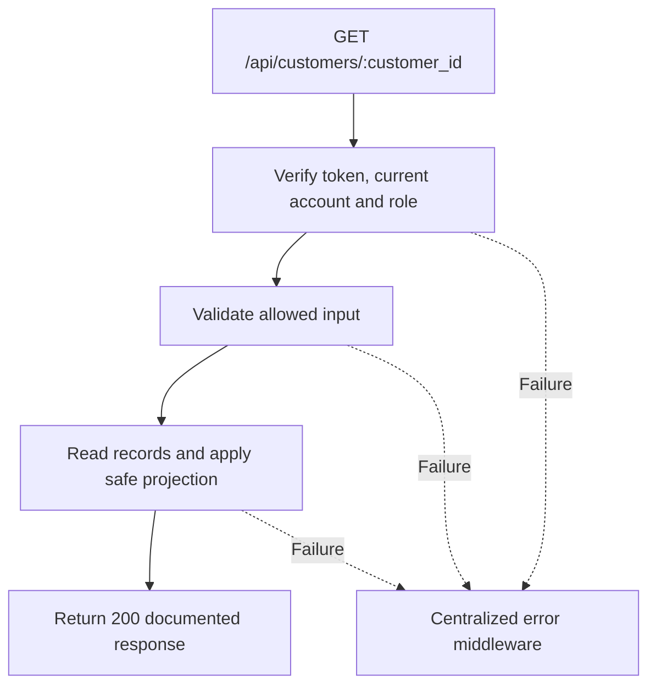

# Task BE-018: View customer profile and financial summary

**Endpoint**: `GET /api/customers/:customer_id`

**Owner**: Member 2 · **Priority**: Must · **Requirement**: FR-CUS-05

**Dependencies**: BE-016, BE-003. Dependencies describe contracts and integration order; use fixtures to begin development before the corresponding endpoint is complete.

## 1. API Documentation

- **Method**: `GET`
- **URL**: `/api/customers/:customer_id`
- **Access**: Any active staff
- **Authentication**: `Authorization: Bearer <access_token>`
- **Content-Type**: `application/json`
- **Path parameters**: `customer_id` (positive integer)

### Request body

None. Do not send a JSON body.

### Success response (200)

```json
{
  "status": "success",
  "message": "View customer profile and financial summary successful",
  "data": {
    "customer_id": 12,
    "first_name": "Sara",
    "last_name": "Tesfaye",
    "email": "sara@example.com",
    "phone": "0912345678",
    "active": true,
    "created_at": "2026-10-25T12:00:00Z",
    "vehicles": [
      {
        "vehicle_id": 8,
        "customer_id": 12,
        "year": 2020,
        "make": "Toyota",
        "model": "Corolla",
        "type": "Sedan",
        "mileage": 65000,
        "plate": "AA-12345",
        "vin": "JTDBR32E720123456",
        "color": "White"
      }
    ],
    "recent_orders": [
      {
        "order_id": 24,
        "customer_id": 12,
        "customer_name": "Sara Tesfaye",
        "vehicle_id": 8,
        "plate": "AA-12345",
        "status": 1,
        "status_name": "Awaiting approval",
        "subtotal": "230.00",
        "vat_rate": "15.00",
        "vat_amount": "34.50",
        "total": "264.50",
        "currency": "ETB",
        "paid": false,
        "created_at": "2026-10-25T12:00:00Z",
        "estimated_ready_date": "2026-10-27T09:00:00Z",
        "completed_at": null
      }
    ],
    "order_count": 1,
    "unpaid_total": "264.50",
    "currency": "ETB"
  }
}
```

Examples use representative fixture records. Responses may have more/fewer array elements; fields and types are contractual. Nullable fields remain present as null. Where a task documents a restricted role projection, that projection replaces the general example for that role.

### Errors

- 400 Invalid input (unless this task specifies a different public-token rule)
- 401 Missing, invalid, expired or revoked access token
- 403 Inactive account or insufficient role
- 404 Customer not found
- 500 Unexpected server error

Shared error format (field errors apply to validation failures):

```json
{
  "status": "error",
  "message": "Validation failed",
  "data": {
    "errors": {
      "email": "Enter a valid email address"
    }
  }
}
```

Non-validation errors use `data: null`, except explicitly documented safe metadata. See [shared conventions](../CONVENTIONS.md).

## 2. Instructions

1. Define route and middleware in `backend/src/api/customers/routes/customer.route.js`.
2. Add `getCustomerValidation` in `backend/src/api/customers/validations/customer.validation.js`.
3. Implement `getCustomerController` in `backend/src/api/customers/controller/customer.controller.js`. Extract allowlisted inputs and verified actor context only.
4. Implement `getCustomerService` in `backend/src/api/customers/service/customer.service.js`. Keep business rules and SQL out of controllers.
5. Share transactions, money/status helpers and notification adapter as described in foundation tasks; do not duplicate other modules’ logic.
6. On errors call `next(error)` from controller catches or use the shared async wrapper. Do not send competing error formats.

## 3. Logic & Git Instructions

### Logic steps

1. Fetch customer or return 404, including inactive records. Return all owned vehicles and the 10 most recent order summaries.
2. unpaid_total sums completed orders with paid=false using stored totals; exclude awaiting, approved, in-progress and declined orders.
3. Use GET /api/orders?customer_id=<id> for paginated full order history. Do not silently truncate without recent_orders and order_count naming.
4. This is staff-only; customer contact details must not be reused by public tracking DTOs.

### Git workflow

```bash
git checkout dev
git pull --ff-only origin dev
git checkout -b codex/be-018-get-customer
# Implement and run task-specific checks
git add <changed-files>
git commit -m "[BE-018] View customer profile and financial summary"
git push -u origin codex/be-018-get-customer
```

Open a PR into dev with requirement IDs, examples and test evidence. One teammate reviews. Coordinate shared route registration through Member 1; module files belong to their listed owner.

### PR checklist and acceptance criteria

- [ ] Successful request returns 200 and exactly the documented safe response shape.
- [ ] Missing/expired/revoked token returns401; inactive account and unauthorized role return403.
- [ ] Verify 404 Customer not found.
- [ ] Invalid/unknown input fields are rejected; no unexpected database changes occur on failure.
- [ ] GET has no data-changing side effects; list pagination/counts stay consistent.
- [ ] All errors go through centralized error middleware; no sensitive fields or stack traces escape.

## 4. Logic Diagram


