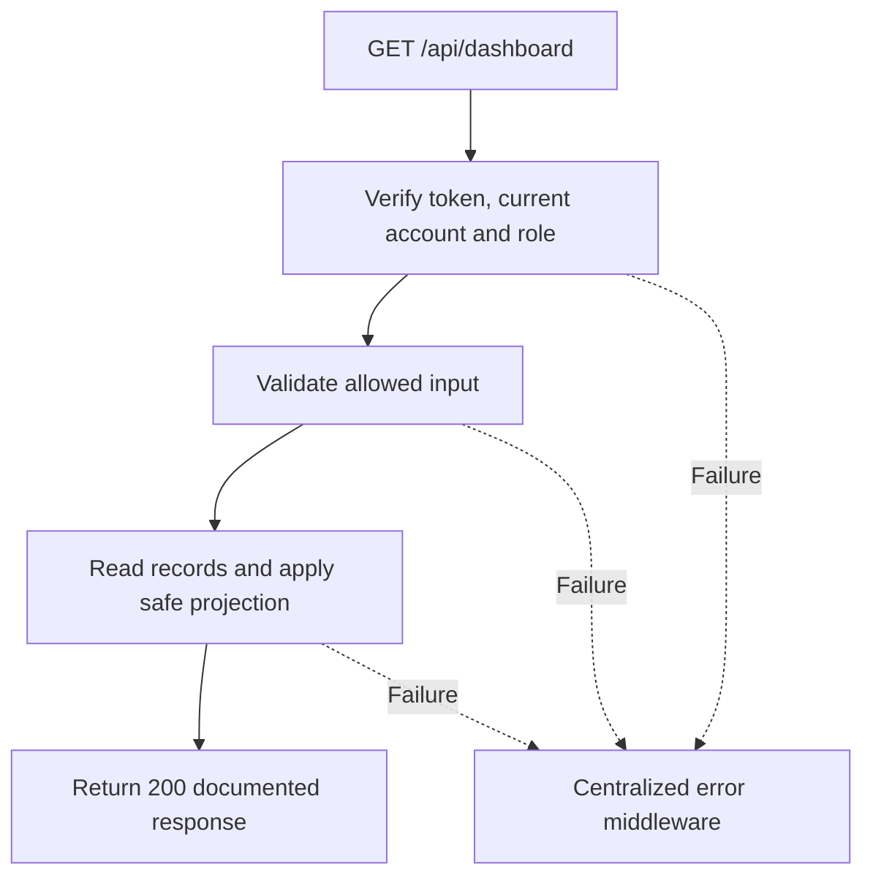

# Task BE-046: Read operational dashboard

**Endpoint**: `GET /api/dashboard`

**Owner**: Member 4 · **Priority**: Must; money totals Should · **Requirement**: FR-DSH-02/03

**Dependencies**: BE-003, BE-042. Dependencies describe contracts and integration order; use fixtures to begin development before the corresponding endpoint is complete.

## 1. API Documentation

- **Method**: `GET`
- **URL**: `/api/dashboard`
- **Access**: Manager or Admin
- **Authentication**: `Authorization: Bearer <access_token>`
- **Content-Type**: `application/json`

### Request body

None. Do not send a JSON body.

### Success response (200)

```json
{
  "status": "success",
  "message": "Read operational dashboard successful",
  "data": {
    "timezone": "Africa/Addis_Ababa",
    "as_of": "2026-10-25T12:00:00Z",
    "counters": {
      "awaiting_approval": 3,
      "in_progress": 4,
      "completed_today": 2,
      "unpaid": 5
    },
    "money": {
      "currency": "ETB",
      "week_start": "2026-10-18T21:00:00Z",
      "month_start": "2026-09-30T21:00:00Z",
      "paid_this_week": "264.50",
      "paid_this_month": "1058.00"
    }
  }
}
```

Examples use representative fixture records. Responses may have more/fewer array elements; fields and types are contractual. Nullable fields remain present as null. Where a task documents a restricted role projection, that projection replaces the general example for that role.

### Errors

- 400 Invalid input (unless this task specifies a different public-token rule)
- 401 Missing, invalid, expired or revoked access token
- 403 Inactive account or insufficient role
- 500 Unexpected server error

Shared error format (field errors apply to validation failures):

```json
{
  "status": "error",
  "message": "Validation failed",
  "data": {
    "errors": {
      "email": "Enter a valid email address"
    }
  }
}
```

Non-validation errors use `data: null`, except explicitly documented safe metadata. See [shared conventions](../CONVENTIONS.md).

## 2. Instructions

1. Define route and middleware in `backend/src/api/dashboard/routes/dashboard.route.js`.
2. Add `getDashboardValidation` in `backend/src/api/dashboard/validations/dashboard.validation.js`.
3. Implement `getDashboardController` in `backend/src/api/dashboard/controller/dashboard.controller.js`. Extract allowlisted inputs and verified actor context only.
4. Implement `getDashboardService` in `backend/src/api/dashboard/service/dashboard.service.js`. Keep business rules and SQL out of controllers.
5. Share transactions, money/status helpers and notification adapter as described in foundation tasks; do not duplicate other modules’ logic.
6. On errors call `next(error)` from controller catches or use the shared async wrapper. Do not send competing error formats.

## 3. Logic & Git Instructions

### Logic steps

1. awaiting_approval counts status1; in_progress counts status3; completed_today uses completed_at in current local day; unpaid counts status4 AND paid=false.
2. Money sums stored totals of paid orders by paid_at. Week starts Monday00:00 in configured GARAGE_TIMEZONE (default Africa/Addis_Ababa); month starts day1. Convert boundaries to UTC before SQL predicates.
3. Return decimal strings and currency; numbers must match order filters. Use inclusive start and exclusive next-boundary timestamps. No technician financial dashboard.
4. Clock fixture for example is2026-10-25T12:00:00Z. Sunday week started Monday2026-10-19 local (2026-10-18T21:00:00Z).

### Git workflow

```bash
git checkout dev
git pull --ff-only origin dev
git checkout -b codex/be-046-get-dashboard
# Implement and run task-specific checks
git add <changed-files>
git commit -m "[BE-046] Read operational dashboard"
git push -u origin codex/be-046-get-dashboard
```

Open a PR into dev with requirement IDs, examples and test evidence. One teammate reviews. Coordinate shared route registration through Member 1; module files belong to their listed owner.

### PR checklist and acceptance criteria

- [ ] Successful request returns 200 and exactly the documented safe response shape.
- [ ] Missing/expired/revoked token returns401; inactive account and unauthorized role return403.
- [ ] Invalid/unknown input fields are rejected; no unexpected database changes occur on failure.
- [ ] GET has no data-changing side effects; list pagination/counts stay consistent.
- [ ] All errors go through centralized error middleware; no sensitive fields or stack traces escape.

## 4. Logic Diagram


