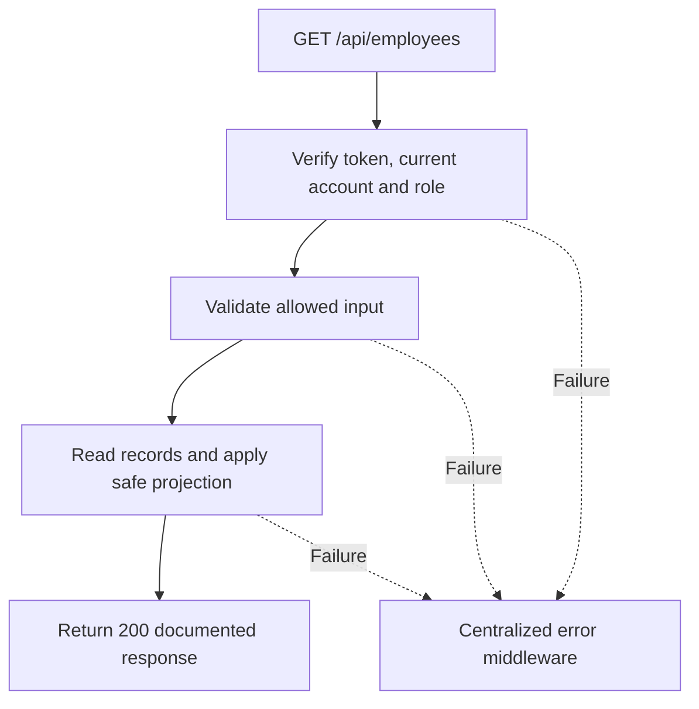

# Task BE-010: List and search employees

**Endpoint**: `GET /api/employees`

**Owner**: Member 1 · **Priority**: Must · **Requirement**: FR-EMP-03 / FR-TEC-01

**Dependencies**: BE-003. Dependencies describe contracts and integration order; use fixtures to begin development before the corresponding endpoint is complete.

## 1. API Documentation

- **Method**: `GET`
- **URL**: `/api/employees`
- **Access**: Admin; Manager limited to active technicians
- **Authentication**: `Authorization: Bearer <access_token>`
- **Content-Type**: `application/json`

### Request body

None. Do not send a JSON body.

### Query parameters example

```json
{
  "search": "abebe",
  "role_id": 1,
  "active": true,
  "page": 1,
  "limit": 10
}
```

See [shared conventions](../CONVENTIONS.md) for types, limits and defaults. All filters are optional. Endpoint-specific behavior is described below.

### Success response (200)

```json
{
  "status": "success",
  "message": "List and search employees successful",
  "data": {
    "employees": [
      {
        "employee_id": 5,
        "first_name": "Abebe",
        "last_name": "Kebede",
        "email": "abebe@abegarage.com",
        "phone": "0911234567",
        "role_id": 1,
        "role_name": "Technician",
        "active": true,
        "created_at": "2026-10-25T12:00:00Z"
      }
    ],
    "pagination": {
      "page": 1,
      "limit": 10,
      "total": 1,
      "total_pages": 1
    }
  }
}
```

Examples use representative fixture records. Responses may have more/fewer array elements; fields and types are contractual. Nullable fields remain present as null. Where a task documents a restricted role projection, that projection replaces the general example for that role.

### Errors

- 400 Invalid input (unless this task specifies a different public-token rule)
- 401 Missing, invalid, expired or revoked access token
- 403 Inactive account or insufficient role
- 403 Managers may only list active technicians
- 500 Unexpected server error

Shared error format (field errors apply to validation failures):

```json
{
  "status": "error",
  "message": "Validation failed",
  "data": {
    "errors": {
      "email": "Enter a valid email address"
    }
  }
}
```

Non-validation errors use `data: null`, except explicitly documented safe metadata. See [shared conventions](../CONVENTIONS.md).

## 2. Instructions

1. Define route and middleware in `backend/src/api/employees/routes/employee.route.js`.
2. Add `listEmployeesValidation` in `backend/src/api/employees/validations/employee.validation.js`.
3. Implement `listEmployeesController` in `backend/src/api/employees/controller/employee.controller.js`. Extract allowlisted inputs and verified actor context only.
4. Implement `listEmployeesService` in `backend/src/api/employees/service/employee.service.js`. Keep business rules and SQL out of controllers.
5. Share transactions, money/status helpers and notification adapter as described in foundation tasks; do not duplicate other modules’ logic.
6. On errors call `next(error)` from controller catches or use the shared async wrapper. Do not send competing error formats.

## 3. Logic & Git Instructions

### Logic steps

1. Validate search, role_id, active, page and limit. Admin may filter any role or active state.
2. For Manager force role_id=1 and active=true. An explicit conflicting filter returns 403. Manager projection is employee_id, first_name, last_name, role_name only; Admin projection matches example.
3. Search first_name, last_name and email; bind search values. Use stable created_at DESC, employee_id DESC ordering, limit/offset and separate count with identical filters.
4. No matches return employees=[] and total=0/total_pages=0. A page beyond the last returns [] with actual total. Never expose hashes or token versions.

### Git workflow

```bash
git checkout dev
git pull --ff-only origin dev
git checkout -b codex/be-010-list-employees
# Implement and run task-specific checks
git add <changed-files>
git commit -m "[BE-010] List and search employees"
git push -u origin codex/be-010-list-employees
```

Open a PR into dev with requirement IDs, examples and test evidence. One teammate reviews. Coordinate shared route registration through Member 1; module files belong to their listed owner.

### PR checklist and acceptance criteria

- [ ] Successful request returns 200 and exactly the documented safe response shape.
- [ ] Missing/expired/revoked token returns401; inactive account and unauthorized role return403.
- [ ] Verify 403 Managers may only list active technicians.
- [ ] Invalid/unknown input fields are rejected; no unexpected database changes occur on failure.
- [ ] GET has no data-changing side effects; list pagination/counts stay consistent.
- [ ] All errors go through centralized error middleware; no sensitive fields or stack traces escape.

## 4. Logic Diagram


