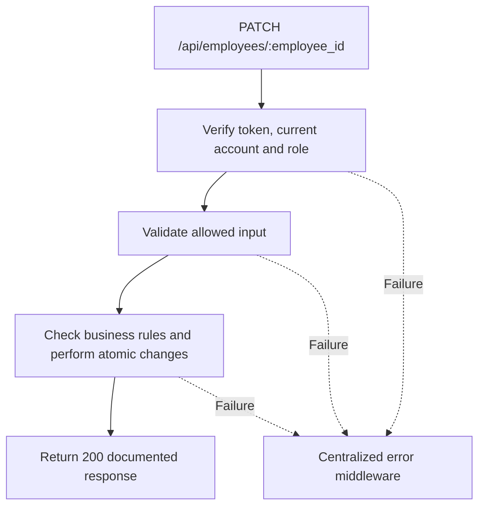

# Task BE-012: Edit or deactivate employee

**Endpoint**: `PATCH /api/employees/:employee_id`

**Owner**: Member 1 · **Priority**: Must · **Requirement**: FR-EMP-04/05

**Dependencies**: BE-009. Dependencies describe contracts and integration order; use fixtures to begin development before the corresponding endpoint is complete.

## 1. API Documentation

- **Method**: `PATCH`
- **URL**: `/api/employees/:employee_id`
- **Access**: Admin
- **Authentication**: `Authorization: Bearer <access_token>`
- **Content-Type**: `application/json`
- **Path parameters**: `employee_id` (positive integer)

### Request body

```json
{
  "phone": "0911000000",
  "role_id": 2,
  "active": true
}
```

### Success response (200)

```json
{
  "status": "success",
  "message": "Edit or deactivate employee successful",
  "data": {
    "employee_id": 5,
    "first_name": "Abebe",
    "last_name": "Kebede",
    "email": "abebe@abegarage.com",
    "phone": "0911000000",
    "role_id": 2,
    "role_name": "Manager",
    "active": true,
    "created_at": "2026-10-25T12:00:00Z"
  }
}
```

Examples use representative fixture records. Responses may have more/fewer array elements; fields and types are contractual. Nullable fields remain present as null. Where a task documents a restricted role projection, that projection replaces the general example for that role.

### Errors

- 400 Invalid input (unless this task specifies a different public-token rule)
- 401 Missing, invalid, expired or revoked access token
- 403 Inactive account or insufficient role
- 404 Employee not found
- 409 Email already used
- 409 At least one active Admin is required
- 500 Unexpected server error

Shared error format (field errors apply to validation failures):

```json
{
  "status": "error",
  "message": "Validation failed",
  "data": {
    "errors": {
      "email": "Enter a valid email address"
    }
  }
}
```

Non-validation errors use `data: null`, except explicitly documented safe metadata. See [shared conventions](../CONVENTIONS.md).

## 2. Instructions

1. Define route and middleware in `backend/src/api/employees/routes/employee.route.js`.
2. Add `updateEmployeeValidation` in `backend/src/api/employees/validations/employee.validation.js`.
3. Implement `updateEmployeeController` in `backend/src/api/employees/controller/employee.controller.js`. Extract allowlisted inputs and verified actor context only.
4. Implement `updateEmployeeService` in `backend/src/api/employees/service/employee.service.js`. Keep business rules and SQL out of controllers.
5. Share transactions, money/status helpers and notification adapter as described in foundation tasks; do not duplicate other modules’ logic.
6. On errors call `next(error)` from controller catches or use the shared async wrapper. Do not send competing error formats.

## 3. Logic & Git Instructions

### Logic steps

1. Allow first_name,last_name,email,phone,role_id,active only. Require at least one field; reject unknown fields and direct password changes.
2. Lock all Admin-role employee rows in a consistent order before target updates so concurrent demotions/deactivations cannot remove the last active Admin. Reject loss of the last active Admin with 409.
3. Enforce unique normalized email. A role change or any active-flag change increments token_version; email change invalidates outstanding reset tokens. Staff must log in again after role/active changes.
4. Do not delete employees. Existing job/order foreign keys remain. Deactivated employees disappear from assignment candidates. Existing assignments remain visible; Manager reassigns unfinished work.
5. Update transactionally and return safe employee. Do not accept a second password through this endpoint.

### Git workflow

```bash
git checkout dev
git pull --ff-only origin dev
git checkout -b codex/be-012-update-employee
# Implement and run task-specific checks
git add <changed-files>
git commit -m "[BE-012] Edit or deactivate employee"
git push -u origin codex/be-012-update-employee
```

Open a PR into dev with requirement IDs, examples and test evidence. One teammate reviews. Coordinate shared route registration through Member 1; module files belong to their listed owner.

### PR checklist and acceptance criteria

- [ ] Successful request returns 200 and exactly the documented safe response shape.
- [ ] Missing/expired/revoked token returns401; inactive account and unauthorized role return403.
- [ ] Verify 404 Employee not found.
- [ ] Verify 409 Email already used.
- [ ] Verify 409 At least one active Admin is required.
- [ ] Invalid/unknown input fields are rejected; no unexpected database changes occur on failure.
- [ ] Transaction/concurrency behavior and repeated-request behavior match the logic below.
- [ ] All errors go through centralized error middleware; no sensitive fields or stack traces escape.

## 4. Logic Diagram


