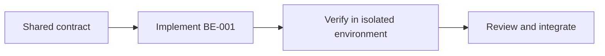

# Task BE-001: Project structure and local runtime

**Owner**: Member 1 · **Priority**: Must

**Dependencies**: None

## 1. API Documentation

Shared infrastructure task; no independent business endpoint or response body. Endpoint behavior is specified in linked task files and [CONVENTIONS.md](../CONVENTIONS.md).

## 2. Instructions

1. Create backend/package.json with dev,start,test scripts; use one supported Node runtime across team and commit lockfile. Use ES modules consistently.
2. Folders: backend/src/app.js; server.js; api/<module>/{routes,controller,service,validations}; middleware;utils/errors;shared; backend/db/{migrations,seeds};tests.
3. Create .env.example containing PORT,NODE_ENV,DB_HOST,DB_PORT,DB_USER,DB_PASSWORD,DB_NAME,JWT_SECRET,JWT_ISSUER,JWT_AUDIENCE,JWT_EXPIRES_IN_SECONDS,FRONTEND_URL,CORS_ORIGIN,SMTP_HOST,SMTP_PORT,SMTP_SECURE,SMTP_USER,SMTP_PASSWORD,MAIL_FROM,GARAGE_TIMEZONE,CURRENCY_CODE,INSTALL_ENABLED,INSTALL_SECRET and initial garage/admin seed settings. Ignore real .env and all credentials.
4. Configure mysql2 promise pool and UTC; provide withTransaction helper using one connection and finally release. Enable JSON body limit256KB and explicit CORS allowlist.
5. Add minimal fixtures and injectable repositories/mail adapter so other members can work independently on Day1. Everyone runs separate local DB; shared staging DB has no real customer data.
6. Backend routes are module routers; Member1 coordinates route mounting, not every implementation PR. Freeze contracts first, then small daily merges.

## 3. Logic & Git Instructions

Branch: `codex/be-001-project-foundation`; start from updated dev, commit with [BE-001], open PR into dev for teammate review.

### PR checklist

- [ ] Every instruction has implementation or verification evidence.
- [ ] Local README and env examples are updated where required.
- [ ] No secrets or generated database dumps committed.
- [ ] Agreed contracts remain unchanged or affected owners reviewed the change.

## 4. Logic Diagram

