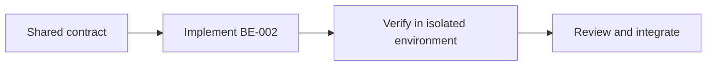

# Task BE-002: Database migrations and deterministic seed data

**Owner**: Member 1 · **Priority**: Must

**Dependencies**: BE-001

## 1. API Documentation

Shared infrastructure task; no independent business endpoint or response body. Endpoint behavior is specified in linked task files and [CONVENTIONS.md](../CONVENTIONS.md).

## 2. Instructions

1. Create ten business tables from ER diagram:roles,employees,customers,vehicles,services,orders,order_lines,order_history,garage_settings,password_reset_tokens. Apply the explicit additions in DATABASE-CHANGES.md.
2. Use InnoDB,utf8mb4,matching FK signedness and DECIMAL money. Unique employee/customer emails,customer phone,vehicle plate,service name,order hash,reset hash and invoice number. Preserve referenced records with RESTRICT rather than cascade delete.
3. Add indexes on orders(status,created_at),orders(paid,status),orders(customer_id,created_at),orders(vehicle_id,created_at),orders(paid_at),order_lines(order_id),order_lines(technician_id,line_status),order_history(order_id,created_at),password_reset_tokens(employee_id,used_at,expires_at). Measure before adding more.
4. Seed fixed roles1 Technician,2 Manager,3 Admin; one singleton settings row and environment-defined initial Admin. Development fixtures include each role,active/inactive staff,customer and vehicles,service prices50.00/180.00,orders in all5 states,paid/unpaid and history.
5. Track applied migrations in an operational schema_migrations ledger (not a new domain resource). Use consistent schema owner review; developers contribute migrations rather than editing production tables manually.
6. Keep a test seed script for1000 orders. Migrations/seed rerun without duplicates. MySQL DDL implicit commits require staged installation; rollback assertions apply to DML transactions, not whole CREATE TABLE batches.
7. Verify vehicle.customer_id matches order.customer_id in order service under lock. Consider composite FK if supported by final DDL; never rely solely on frontend checks.

## 3. Logic & Git Instructions

Branch: `codex/be-002-database-and-seeds`; start from updated dev, commit with [BE-002], open PR into dev for teammate review.

### PR checklist

- [ ] Every instruction has implementation or verification evidence.
- [ ] Local README and env examples are updated where required.
- [ ] No secrets or generated database dumps committed.
- [ ] Agreed contracts remain unchanged or affected owners reviewed the change.

## 4. Logic Diagram

