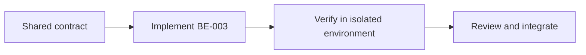

# Task BE-003: Shared authentication, authorization, validation and error middleware

**Owner**: Member 1 · **Priority**: Must

**Dependencies**: BE-001, BE-002

## 1. API Documentation

Shared infrastructure task; no independent business endpoint or response body. Endpoint behavior is specified in linked task files and [CONVENTIONS.md](../CONVENTIONS.md).

## 2. Instructions

1. Implement AppError and typed BadRequest,Unauthorized,Forbidden,NotFound,Conflict,RateLimit,ServiceUnavailable errors. Carry safe field details separately from internal diagnostics.
2. Use express-validator or equivalent consistently; validation handler produces400 with data.errors. Reject unknown fields,empty PATCH and malformed JSON. Use centralized positive-ID,query-boolean,pagination and money validation helpers.
3. Authenticate Bearer JWT and verify algorithm,issuer,audience,token_use,signature and expiry. Read current employee/role/active/token_version from MySQL; middleware cannot trust stored frontend profile or stale JWT role.
4. Use hasRole(...roles) authorization plus resource-level assignment checks inside services under locks. Authentication401 precedes authorization403; do not expose missing resource existence to unauthorized roles.
5. Implement JSON not-found handler then error middleware (err,req,res,next). Express4 async callbacks must catch/next(error) or use shared async wrapper. If headers already sent delegate next(error).
6. Translate SQL duplicate to409 without exposing raw DB error. Generic500 for unknown failures; log sanitized request ID,stack internally. Never pass SQL syntax or err.message indiscriminately to users.
7. Shared output serialization converts decimals to fixed strings,dates UTC and flags booleans. Public DTOs use explicit allowlists. SQL values parameterized; dynamic structural pieces from constants only.
8. Implement rate limits/login/reset/public lookup/resend and Retry-After on429. Audit every mutation in order_history using fixed action keys and actor/time; allow null actor for automated delivery events.

## 3. Logic & Git Instructions

Branch: `codex/be-003-auth-validation-errors`; start from updated dev, commit with [BE-003], open PR into dev for teammate review.

### PR checklist

- [ ] Every instruction has implementation or verification evidence.
- [ ] Local README and env examples are updated where required.
- [ ] No secrets or generated database dumps committed.
- [ ] Agreed contracts remain unchanged or affected owners reviewed the change.

## 4. Logic Diagram

