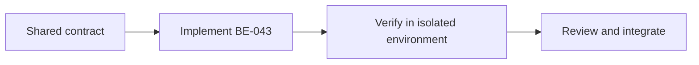

# Task BE-043: Shared email adapter and automatic order notifications

**Owner**: Member 4 · **Priority**: Must

**Dependencies**: BE-001, BE-002

## 1. API Documentation

Shared infrastructure task; no independent business endpoint or response body. Endpoint behavior is specified in linked task files and [CONVENTIONS.md](../CONVENTIONS.md).

## 2. Instructions

1. Expose in-process sendPasswordResetEmail,sendOrderCreatedEmail,sendCarReadyEmail and resendOrderEmail adapters with a fake implementation for local tests. No public generic send-email endpoint.
2. Configure SMTP solely from env and escape all dynamic HTML. Build absolute HTTPS URLs from FRONTEND_URL; never untrusted Host. Only the password-reset delivery receives raw reset token.
3. On order creation/completion services call adapter after successful DB commit. Adapter records email_sent or email_failed in order_history with nullable employee_id and timestamp. Completion actor can be included when known; never store raw tracking/reset tokens in history.
4. Catch SMTP failures in automatic hooks and never let them reject an already committed order request. Explicit resend propagates a controlled503; forgot-password keeps its generic response even on delivery failure.
5. Completion hook fires only for transaction that actually changes status to4. Set bounded SMTP connection/send timeouts. SMTP acceptance is not inbox delivery; include manual Copy link frontend fallback.
6. Transactional outbox/exactly-once delivery is not claimed by this10-table design. Record and surface failures; future durable queue needs a separate agreed migration. Fake SMTP failure test is mandatory.
7. Member1 owns reset-token creation and eligibility; Member4 owns delivery mechanics. Adapter contract can be delivered first with mock mail, allowing auth and orders to proceed independently.

## 3. Logic & Git Instructions

Branch: `codex/be-043-notification-adapter`; start from updated dev, commit with [BE-043], open PR into dev for teammate review.

### PR checklist

- [ ] Every instruction has implementation or verification evidence.
- [ ] Local README and env examples are updated where required.
- [ ] No secrets or generated database dumps committed.
- [ ] Agreed contracts remain unchanged or affected owners reviewed the change.

## 4. Logic Diagram

