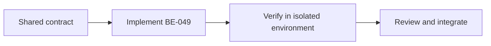

# Task BE-049: Shared backend integration and acceptance tests

**Owner**: Member 4 · **Priority**: Must

**Dependencies**: BE-003

## 1. API Documentation

Shared infrastructure task; no independent business endpoint or response body. Endpoint behavior is specified in linked task files and [CONVENTIONS.md](../CONVENTIONS.md).

## 2. Instructions

1. Every endpoint owner supplies runnable Postman requests for success and documented error cases plus test evidence. Member4 assembles shared collection/environment; no real secrets committed.
2. Test complete workflow:new customer→vehicle→estimate→approval→assign→start→done→issue invoice→cash payment→public tracking. Verify decline blocks work/invoice/payment.
3. Test wrong roles,expired/revoked tokens,deactivated staff,duplicate emails/phones/plates,invalid fields,customer/vehicle mismatch,transaction rollback and public data privacy.
4. Test concurrent job completions,concurrent last-Admin changes,repeated payment/invoice requests,single-use reset race and paused progress during reapproval.
5. Change catalogue prices,garage settings and customer/vehicle data after invoice issuance; assert old invoice unchanged. Test VAT230.00→34.50→264.50 and0.01 rounding edge cases.
6. Mail failure never blocks order creation/completion. Password reset never reveals account eligibility; old access tokens revoked after password reset/change.
7. With1000 seeded orders,measure list queries end to end against under2s target; verify pages/counts and dashboard boundary timezone cases. Tests use isolated nonproduction DB.
8. Central error handler is tested for malformed JSON,unknown route,DB error and thrown async error; response envelope must remain consistent.

## 3. Logic & Git Instructions

Branch: `codex/be-049-backend-acceptance-tests`; start from updated dev, commit with [BE-049], open PR into dev for teammate review.

### PR checklist

- [ ] Every instruction has implementation or verification evidence.
- [ ] Local README and env examples are updated where required.
- [ ] No secrets or generated database dumps committed.
- [ ] Agreed contracts remain unchanged or affected owners reviewed the change.

## 4. Logic Diagram

