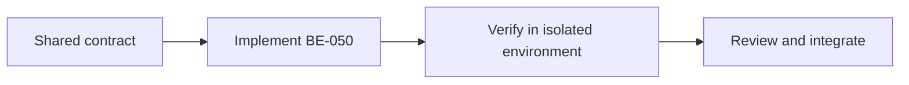

# Task BE-050: Backend deployment and handover

**Owner**: Member 1 · **Priority**: Must

**Dependencies**: BE-047, BE-048, BE-049

## 1. API Documentation

Shared infrastructure task; no independent business endpoint or response body. Endpoint behavior is specified in linked task files and [CONVENTIONS.md](../CONVENTIONS.md).

## 2. Instructions

1. Deploy skeleton early to chosen backend host with persistent MySQL; verify allowed SMTP outbound traffic. Confirm platform current limits before choosing; no specific paid plan is mandated.
2. Set production secrets,frontend/CORS URLs,UTC DB timezone,Africa/Addis_Ababa business timezone and launch currency. Set NODE_ENV=production,HTTPS and correct trust-proxy only for known proxy topology.
3. Apply versioned migrations,seed initial Admin securely,disable/lock installation and rotate temporary setup credentials. Do not deploy sample passwords or production development seed data.
4. Configure readiness health,process restart,structured redacted logs,DB backup schedule and one restore rehearsal in a separate database. Restrict DB network access to backend.
5. Run deployed acceptance collection with isolated synthetic records; test email,auth,reset,invoice/payment,public privacy and401/403 handling.
6. Deliver README with local setup,env variables,migration/seed commands,run/test commands,deployment/rollback procedure and endpoint/task index. Rollback must account for schema compatibility; do not blindly run destructive down migrations.

## 3. Logic & Git Instructions

Branch: `codex/be-050-backend-deployment`; start from updated dev, commit with [BE-050], open PR into dev for teammate review.

### PR checklist

- [ ] Every instruction has implementation or verification evidence.
- [ ] Local README and env examples are updated where required.
- [ ] No secrets or generated database dumps committed.
- [ ] Agreed contracts remain unchanged or affected owners reviewed the change.

## 4. Logic Diagram

