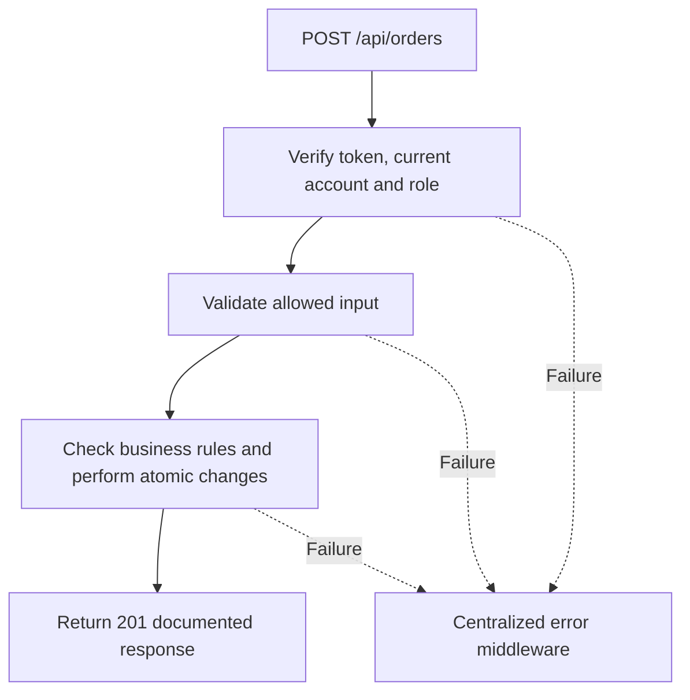

# Task BE-029: Create repair order and estimate

**Endpoint**: `POST /api/orders`

**Owner**: Member 3 · **Priority**: Must · **Requirement**: FR-ORD-01/02/04 / FR-TRK-01/05/06

**Dependencies**: BE-003, BE-016, BE-020, BE-025, BE-043. Dependencies describe contracts and integration order; use fixtures to begin development before the corresponding endpoint is complete.

## 1. API Documentation

- **Method**: `POST`
- **URL**: `/api/orders`
- **Access**: Manager or Admin
- **Authentication**: `Authorization: Bearer <access_token>`
- **Content-Type**: `application/json`

### Request body

```json
{
  "customer_id": 12,
  "vehicle_id": 8,
  "lines": [
    {
      "service_id": 3
    },
    {
      "service_id": 4
    }
  ],
  "estimated_ready_date": "2026-10-27T09:00:00Z",
  "notes_for_customer": "Please call before collection.",
  "internal_notes": "Check previous repair record."
}
```

### Success response (201)

```json
{
  "status": "success",
  "message": "Create repair order and estimate successful",
  "data": {
    "order_id": 24,
    "customer_id": 12,
    "customer_name": "Sara Tesfaye",
    "vehicle_id": 8,
    "plate": "AA-12345",
    "status": 1,
    "status_name": "Awaiting approval",
    "subtotal": "230.00",
    "vat_rate": "15.00",
    "vat_amount": "34.50",
    "total": "264.50",
    "currency": "ETB",
    "paid": false,
    "created_at": "2026-10-25T12:00:00Z",
    "estimated_ready_date": "2026-10-27T09:00:00Z",
    "completed_at": null,
    "created_by": 2,
    "order_hash": "7da3e09c8bb1fa52d17e25ccafd8ec144c9bf744f806d48160a1e0b2ba7f35ca2",
    "tracking_url": "https://garage.example/order-status/7da3e09c8bb1fa52d17e25ccafd8ec144c9bf744f806d48160a1e0b2ba7f35ca2",
    "customer": {
      "customer_id": 12,
      "first_name": "Sara",
      "last_name": "Tesfaye",
      "email": "sara@example.com",
      "phone": "0912345678",
      "active": true,
      "created_at": "2026-10-25T12:00:00Z"
    },
    "vehicle": {
      "vehicle_id": 8,
      "customer_id": 12,
      "year": 2020,
      "make": "Toyota",
      "model": "Corolla",
      "type": "Sedan",
      "mileage": 65000,
      "plate": "AA-12345",
      "vin": "JTDBR32E720123456",
      "color": "White"
    },
    "lines": [
      {
        "line_id": 41,
        "order_id": 24,
        "service_id": 3,
        "service_name": "Oil change",
        "service_description": "Replace engine oil and filter",
        "labor_hours": "0.50",
        "line_price": "50.00",
        "technician_id": null,
        "technician_name": null,
        "line_status": 0,
        "started_at": null,
        "done_at": null,
        "technician_note": null
      },
      {
        "line_id": 42,
        "order_id": 24,
        "service_id": 4,
        "service_name": "Brake service",
        "service_description": "Inspect and service brakes",
        "labor_hours": "2.00",
        "line_price": "180.00",
        "technician_id": null,
        "technician_name": null,
        "line_status": 0,
        "started_at": null,
        "done_at": null,
        "technician_note": null
      }
    ],
    "approved_by": null,
    "approved_at": null,
    "approval_method": null,
    "paid_at": null,
    "paid_received_by": null,
    "notes_for_customer": "Please call before collection.",
    "internal_notes": "Check previous repair record.",
    "history": [
      {
        "history_id": 91,
        "order_id": 24,
        "employee_id": 2,
        "employee_name": "Hana Bekele",
        "action": "order_created",
        "created_at": "2026-10-25T12:00:00Z"
      }
    ]
  }
}
```

Examples use representative fixture records. Responses may have more/fewer array elements; fields and types are contractual. Nullable fields remain present as null. Where a task documents a restricted role projection, that projection replaces the general example for that role.

### Errors

- 400 Invalid input (unless this task specifies a different public-token rule)
- 401 Missing, invalid, expired or revoked access token
- 403 Inactive account or insufficient role
- 404 Customer, vehicle or service not found
- 409 Vehicle does not belong to customer
- 409 Customer or service is inactive
- 500 Unexpected server error

Shared error format (field errors apply to validation failures):

```json
{
  "status": "error",
  "message": "Validation failed",
  "data": {
    "errors": {
      "email": "Enter a valid email address"
    }
  }
}
```

Non-validation errors use `data: null`, except explicitly documented safe metadata. See [shared conventions](../CONVENTIONS.md).

## 2. Instructions

1. Define route and middleware in `backend/src/api/orders/routes/order.route.js`.
2. Add `createOrderValidation` in `backend/src/api/orders/validations/order.validation.js`.
3. Implement `createOrderController` in `backend/src/api/orders/controller/order.controller.js`. Extract allowlisted inputs and verified actor context only.
4. Implement `createOrderService` in `backend/src/api/orders/service/order.service.js`. Keep business rules and SQL out of controllers.
5. Share transactions, money/status helpers and notification adapter as described in foundation tasks; do not duplicate other modules’ logic.
6. On errors call `next(error)` from controller catches or use the shared async wrapper. Do not send competing error formats.

## 3. Logic & Git Instructions

### Logic steps

1. Validate customer,vehicle,nonempty lines array (max 100), future estimated_ready_date and notes lengths. Unknown fields are rejected; client cannot set status,totals,hash,paid,creator or invoice fields.
2. In one transaction lock customer/vehicle and selected services; verify active customer, vehicle ownership and active unique service IDs. Reject a car belonging to another customer (409).
3. Copy service name,description,labor_hours and price to order_lines snapshots. Optional custom line_price follows BE-032/BE-034 policy; server always computes totals. New lines are unassigned.
4. Read settings.vat_rate into orders.vat_rate, sum prices in integer minor units, round VAT once on subtotal, and persist subtotal/vat/total. Example 230.00 + 34.50 = 264.50.
5. Set status=1,paid=false, created_by from token; create 32-byte random hex order_hash and initial history. Roll back all rows on any failure.
6. After commit call shared notification adapter (BE-043) for order_created email. Delivery failure cannot change successful 201 or roll back order. Record email_sent/email_failed history separately. Return full order; client may refetch detail to see delivery outcome.

### Git workflow

```bash
git checkout dev
git pull --ff-only origin dev
git checkout -b codex/be-029-create-order
# Implement and run task-specific checks
git add <changed-files>
git commit -m "[BE-029] Create repair order and estimate"
git push -u origin codex/be-029-create-order
```

Open a PR into dev with requirement IDs, examples and test evidence. One teammate reviews. Coordinate shared route registration through Member 1; module files belong to their listed owner.

### PR checklist and acceptance criteria

- [ ] Successful request returns 201 and exactly the documented safe response shape.
- [ ] Missing/expired/revoked token returns401; inactive account and unauthorized role return403.
- [ ] Verify 404 Customer, vehicle or service not found.
- [ ] Verify 409 Vehicle does not belong to customer.
- [ ] Verify 409 Customer or service is inactive.
- [ ] Invalid/unknown input fields are rejected; no unexpected database changes occur on failure.
- [ ] Transaction/concurrency behavior and repeated-request behavior match the logic below.
- [ ] All errors go through centralized error middleware; no sensitive fields or stack traces escape.

## 4. Logic Diagram


