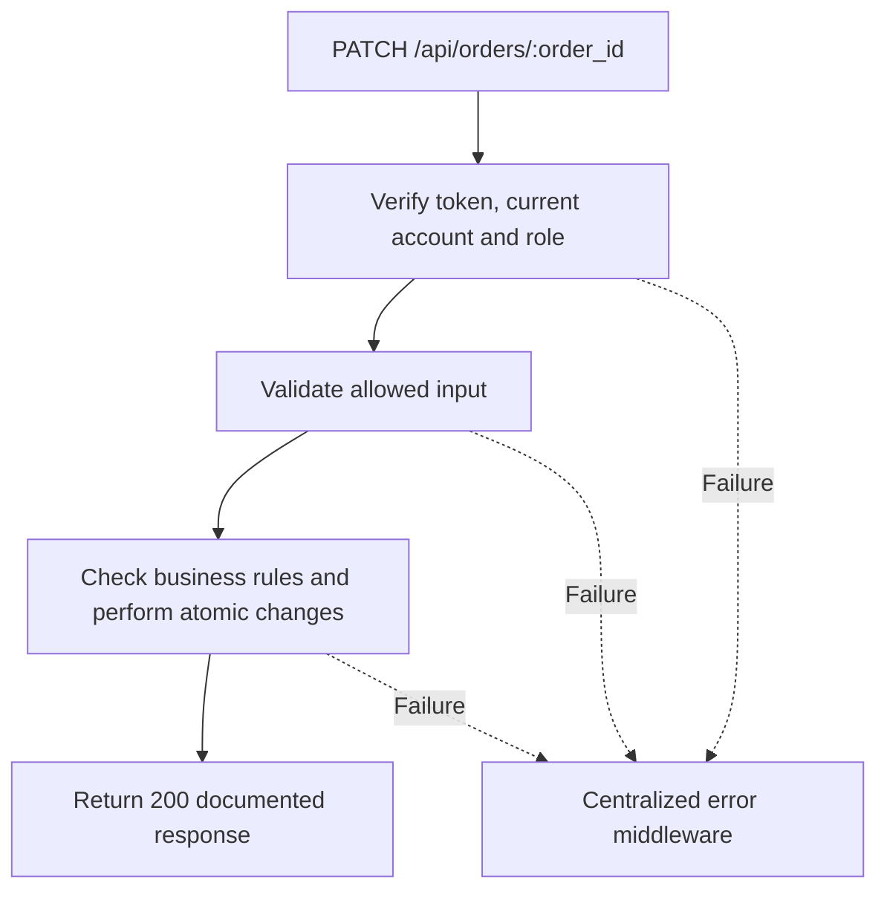

# Task BE-032: Edit estimate or order notes

**Endpoint**: `PATCH /api/orders/:order_id`

**Owner**: Member 3 · **Priority**: Must; custom prices Should · **Requirement**: FR-ORD-03/07

**Dependencies**: BE-029. Dependencies describe contracts and integration order; use fixtures to begin development before the corresponding endpoint is complete.

## 1. API Documentation

- **Method**: `PATCH`
- **URL**: `/api/orders/:order_id`
- **Access**: Manager or Admin
- **Authentication**: `Authorization: Bearer <access_token>`
- **Content-Type**: `application/json`
- **Path parameters**: `order_id` (positive integer)

### Request body

```json
{
  "lines": [
    {
      "service_id": 3,
      "line_price": "50.00"
    },
    {
      "service_id": 4,
      "line_price": "180.00"
    }
  ],
  "estimated_ready_date": "2026-10-27T10:00:00Z",
  "notes_for_customer": "Ready tomorrow."
}
```

### Success response (200)

```json
{
  "status": "success",
  "message": "Edit estimate or order notes successful",
  "data": {
    "order_id": 24,
    "customer_id": 12,
    "customer_name": "Sara Tesfaye",
    "vehicle_id": 8,
    "plate": "AA-12345",
    "status": 1,
    "status_name": "Awaiting approval",
    "subtotal": "230.00",
    "vat_rate": "15.00",
    "vat_amount": "34.50",
    "total": "264.50",
    "currency": "ETB",
    "paid": false,
    "created_at": "2026-10-25T12:00:00Z",
    "estimated_ready_date": "2026-10-27T10:00:00Z",
    "completed_at": null,
    "created_by": 2,
    "order_hash": "7da3e09c8bb1fa52d17e25ccafd8ec144c9bf744f806d48160a1e0b2ba7f35ca2",
    "tracking_url": "https://garage.example/order-status/7da3e09c8bb1fa52d17e25ccafd8ec144c9bf744f806d48160a1e0b2ba7f35ca2",
    "customer": {
      "customer_id": 12,
      "first_name": "Sara",
      "last_name": "Tesfaye",
      "email": "sara@example.com",
      "phone": "0912345678",
      "active": true,
      "created_at": "2026-10-25T12:00:00Z"
    },
    "vehicle": {
      "vehicle_id": 8,
      "customer_id": 12,
      "year": 2020,
      "make": "Toyota",
      "model": "Corolla",
      "type": "Sedan",
      "mileage": 65000,
      "plate": "AA-12345",
      "vin": "JTDBR32E720123456",
      "color": "White"
    },
    "lines": [
      {
        "line_id": 41,
        "order_id": 24,
        "service_id": 3,
        "service_name": "Oil change",
        "service_description": "Replace engine oil and filter",
        "labor_hours": "0.50",
        "line_price": "50.00",
        "technician_id": 5,
        "technician_name": "Abebe Kebede",
        "line_status": 0,
        "started_at": null,
        "done_at": null,
        "technician_note": null
      },
      {
        "line_id": 42,
        "order_id": 24,
        "service_id": 4,
        "service_name": "Brake service",
        "service_description": "Inspect and service brakes",
        "labor_hours": "2.00",
        "line_price": "180.00",
        "technician_id": null,
        "technician_name": null,
        "line_status": 0,
        "started_at": null,
        "done_at": null,
        "technician_note": null
      }
    ],
    "approved_by": null,
    "approved_at": null,
    "approval_method": null,
    "paid_at": null,
    "paid_received_by": null,
    "notes_for_customer": "Ready tomorrow.",
    "internal_notes": "Check previous repair record.",
    "history": [
      {
        "history_id": 91,
        "order_id": 24,
        "employee_id": 2,
        "employee_name": "Hana Bekele",
        "action": "order_created",
        "created_at": "2026-10-25T12:00:00Z"
      }
    ]
  }
}
```

Examples use representative fixture records. Responses may have more/fewer array elements; fields and types are contractual. Nullable fields remain present as null. Where a task documents a restricted role projection, that projection replaces the general example for that role.

### Errors

- 400 Invalid input (unless this task specifies a different public-token rule)
- 401 Missing, invalid, expired or revoked access token
- 403 Inactive account or insufficient role
- 404 Order not found
- 409 Order is not editable in this state
- 409 Cannot modify performed work or issued invoice lines
- 500 Unexpected server error

Shared error format (field errors apply to validation failures):

```json
{
  "status": "error",
  "message": "Validation failed",
  "data": {
    "errors": {
      "email": "Enter a valid email address"
    }
  }
}
```

Non-validation errors use `data: null`, except explicitly documented safe metadata. See [shared conventions](../CONVENTIONS.md).

## 2. Instructions

1. Define route and middleware in `backend/src/api/orders/routes/order.route.js`.
2. Add `updateOrderValidation` in `backend/src/api/orders/validations/order.validation.js`.
3. Implement `updateOrderController` in `backend/src/api/orders/controller/order.controller.js`. Extract allowlisted inputs and verified actor context only.
4. Implement `updateOrderService` in `backend/src/api/orders/service/order.service.js`. Keep business rules and SQL out of controllers.
5. Share transactions, money/status helpers and notification adapter as described in foundation tasks; do not duplicate other modules’ logic.
6. On errors call `next(error)` from controller catches or use the shared async wrapper. Do not send competing error formats.

## 3. Logic & Git Instructions

### Logic steps

1. Lock order first. In status=1, allow replacing the entire unstarted lines array plus notes/date; retain existing line IDs and assignments for retained services, snapshot fresh data for new services, and remove only unstarted unapproved lines.
2. If a reapproval order already has started/done work, do not remove or reprice those lines. Awaiting approval alone does not authorize rewriting previously performed work.
3. After approval (status 2/3/4), only notes_for_customer,internal_notes and estimated_ready_date may change. Declined orders are read-only. Billing issuance prevents all line/price edits.
4. Custom nonnegative line_price is a Should feature; if implemented, use same policy at creation and update. Unspecified prices for retained lines keep their snapshot; new lines copy current service price. At least one line remains; no duplicate services.
5. Never permit customer_id,vehicle_id,paid,status,vat_rate or calculated totals in update. Recalculate totals from retained snapshots using stored vat_rate and append descriptive history.
6. Return full Manager/Admin detail. For already completed orders do not accept a new future readiness date that contradicts completion; notes remain editable.

### Git workflow

```bash
git checkout dev
git pull --ff-only origin dev
git checkout -b codex/be-032-update-order
# Implement and run task-specific checks
git add <changed-files>
git commit -m "[BE-032] Edit estimate or order notes"
git push -u origin codex/be-032-update-order
```

Open a PR into dev with requirement IDs, examples and test evidence. One teammate reviews. Coordinate shared route registration through Member 1; module files belong to their listed owner.

### PR checklist and acceptance criteria

- [ ] Successful request returns 200 and exactly the documented safe response shape.
- [ ] Missing/expired/revoked token returns401; inactive account and unauthorized role return403.
- [ ] Verify 404 Order not found.
- [ ] Verify 409 Order is not editable in this state.
- [ ] Verify 409 Cannot modify performed work or issued invoice lines.
- [ ] Invalid/unknown input fields are rejected; no unexpected database changes occur on failure.
- [ ] Transaction/concurrency behavior and repeated-request behavior match the logic below.
- [ ] All errors go through centralized error middleware; no sensitive fields or stack traces escape.

## 4. Logic Diagram


