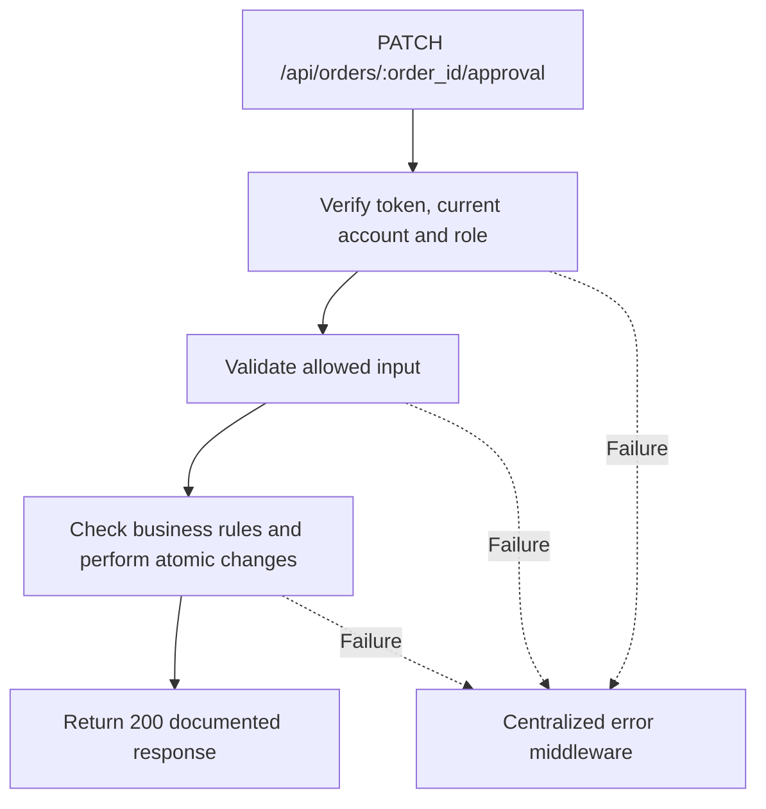

# Task BE-033: Record estimate approval or decline

**Endpoint**: `PATCH /api/orders/:order_id/approval`

**Owner**: Member 3 · **Priority**: Must · **Requirement**: FR-EST-02/03

**Dependencies**: BE-029. Dependencies describe contracts and integration order; use fixtures to begin development before the corresponding endpoint is complete.

## 1. API Documentation

- **Method**: `PATCH`
- **URL**: `/api/orders/:order_id/approval`
- **Access**: Manager or Admin
- **Authentication**: `Authorization: Bearer <access_token>`
- **Content-Type**: `application/json`
- **Path parameters**: `order_id` (positive integer)

### Request body

```json
{
  "decision": "approved",
  "approval_method": "phone"
}
```

### Success response (200)

```json
{
  "status": "success",
  "message": "Record estimate approval or decline successful",
  "data": {
    "order_id": 24,
    "status": 2,
    "status_name": "Approved",
    "approved_by": 2,
    "approved_at": "2026-10-25T12:00:00Z",
    "approval_method": "phone"
  }
}
```

Examples use representative fixture records. Responses may have more/fewer array elements; fields and types are contractual. Nullable fields remain present as null. Where a task documents a restricted role projection, that projection replaces the general example for that role.

### Errors

- 400 Invalid input (unless this task specifies a different public-token rule)
- 401 Missing, invalid, expired or revoked access token
- 403 Inactive account or insufficient role
- 404 Order not found
- 409 Order is not awaiting approval
- 409 Cannot decline an estimate with performed work
- 500 Unexpected server error

Shared error format (field errors apply to validation failures):

```json
{
  "status": "error",
  "message": "Validation failed",
  "data": {
    "errors": {
      "email": "Enter a valid email address"
    }
  }
}
```

Non-validation errors use `data: null`, except explicitly documented safe metadata. See [shared conventions](../CONVENTIONS.md).

## 2. Instructions

1. Define route and middleware in `backend/src/api/orders/routes/order.route.js`.
2. Add `recordApprovalValidation` in `backend/src/api/orders/validations/order.validation.js`.
3. Implement `recordApprovalController` in `backend/src/api/orders/controller/order.controller.js`. Extract allowlisted inputs and verified actor context only.
4. Implement `recordApprovalService` in `backend/src/api/orders/service/order.service.js`. Keep business rules and SQL out of controllers.
5. Share transactions, money/status helpers and notification adapter as described in foundation tasks; do not duplicate other modules’ logic.
6. On errors call `next(error)` from controller catches or use the shared async wrapper. Do not send competing error formats.

## 3. Logic & Git Instructions

### Logic steps

1. Accept decision=approved|declined; approval_method=phone|in_person required for both. Actor/time are server-generated. Lock order before state checks.
2. Only status=1 may accept a new decision. Initial approval sets approved_by/approved_at/method; next job start may proceed. Decline sets status=5 and writes actor/method/time to history; no repair,invoice or payment allowed.
3. For reapproval with existing progress: approving derives status=3 if any work started,4 if all done, otherwise2. If this newly completes order, trigger readiness email once after commit.
4. If customer declines extra work after performed work exists, return 409 for this release; do not erase or terminally decline performed work. Manager removes only unstarted extra lines and obtains approval for the retained scope, or resolves the case outside this release.
5. Write history for every accepted decision. Repeating an already applied decision returns 409; prevent duplicate approval history under concurrency.
6. Decline response uses status5,status_name=Declined,approved_by=null,approved_at=null and approval_method supplied; history.details stores decision actor,time and method. Reapproval response reflects derived status2/3/4, not always2.

### Git workflow

```bash
git checkout dev
git pull --ff-only origin dev
git checkout -b codex/be-033-record-approval
# Implement and run task-specific checks
git add <changed-files>
git commit -m "[BE-033] Record estimate approval or decline"
git push -u origin codex/be-033-record-approval
```

Open a PR into dev with requirement IDs, examples and test evidence. One teammate reviews. Coordinate shared route registration through Member 1; module files belong to their listed owner.

### PR checklist and acceptance criteria

- [ ] Successful request returns 200 and exactly the documented safe response shape.
- [ ] Missing/expired/revoked token returns401; inactive account and unauthorized role return403.
- [ ] Verify 404 Order not found.
- [ ] Verify 409 Order is not awaiting approval.
- [ ] Verify 409 Cannot decline an estimate with performed work.
- [ ] Invalid/unknown input fields are rejected; no unexpected database changes occur on failure.
- [ ] Transaction/concurrency behavior and repeated-request behavior match the logic below.
- [ ] All errors go through centralized error middleware; no sensitive fields or stack traces escape.

## 4. Logic Diagram


