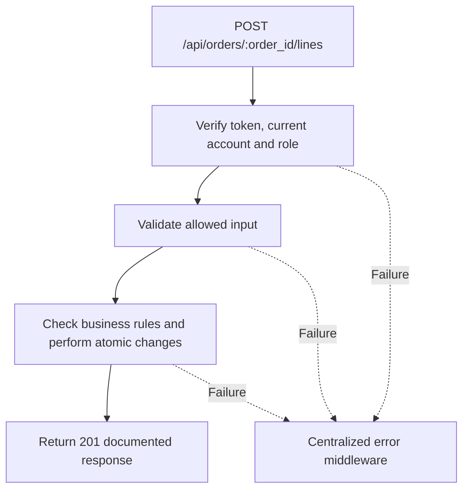

# Task BE-034: Add extra work and request reapproval

**Endpoint**: `POST /api/orders/:order_id/lines`

**Owner**: Member 3 · **Priority**: Should · **Requirement**: FR-EST-04 / FR-ORD-03

**Dependencies**: BE-032, BE-033. Dependencies describe contracts and integration order; use fixtures to begin development before the corresponding endpoint is complete.

## 1. API Documentation

- **Method**: `POST`
- **URL**: `/api/orders/:order_id/lines`
- **Access**: Manager or Admin
- **Authentication**: `Authorization: Bearer <access_token>`
- **Content-Type**: `application/json`
- **Path parameters**: `order_id` (positive integer)

### Request body

```json
{
  "service_id": 7,
  "line_price": "90.00"
}
```

### Success response (201)

```json
{
  "status": "success",
  "message": "Add extra work and request reapproval successful",
  "data": {
    "order_id": 24,
    "status": 1,
    "status_name": "Awaiting approval",
    "added_line": {
      "line_id": 43,
      "order_id": 24,
      "service_id": 7,
      "service_name": "Wheel alignment",
      "service_description": "Align wheels",
      "labor_hours": "0.50",
      "line_price": "90.00",
      "technician_id": null,
      "technician_name": null,
      "line_status": 0,
      "started_at": null,
      "done_at": null,
      "technician_note": null
    },
    "subtotal": "320.00",
    "vat_rate": "15.00",
    "vat_amount": "48.00",
    "total": "368.00",
    "currency": "ETB"
  }
}
```

Examples use representative fixture records. Responses may have more/fewer array elements; fields and types are contractual. Nullable fields remain present as null. Where a task documents a restricted role projection, that projection replaces the general example for that role.

### Errors

- 400 Invalid input (unless this task specifies a different public-token rule)
- 401 Missing, invalid, expired or revoked access token
- 403 Inactive account or insufficient role
- 404 Order or service not found
- 409 Extra work cannot be added in this state
- 409 Service is inactive or already present
- 500 Unexpected server error

Shared error format (field errors apply to validation failures):

```json
{
  "status": "error",
  "message": "Validation failed",
  "data": {
    "errors": {
      "email": "Enter a valid email address"
    }
  }
}
```

Non-validation errors use `data: null`, except explicitly documented safe metadata. See [shared conventions](../CONVENTIONS.md).

## 2. Instructions

1. Define route and middleware in `backend/src/api/orders/routes/order.route.js`.
2. Add `addExtraJobValidation` in `backend/src/api/orders/validations/order.validation.js`.
3. Implement `addExtraJobController` in `backend/src/api/orders/controller/order.controller.js`. Extract allowlisted inputs and verified actor context only.
4. Implement `addExtraJobService` in `backend/src/api/orders/service/order.service.js`. Keep business rules and SQL out of controllers.
5. Share transactions, money/status helpers and notification adapter as described in foundation tasks; do not duplicate other modules’ logic.
6. On errors call `next(error)` from controller catches or use the shared async wrapper. Do not send competing error formats.

## 3. Logic & Git Instructions

### Logic steps

1. Lock order and verify service exists,active and not already on order. Allow additions in status 1/2/3 only and before invoice issuance; reject completed/declined/paid orders.
2. Snapshot new service data and optional custom price; recompute totals with stored VAT rate. Clear current approval fields when invalidating approval, retaining prior approvals in history.
3. Set order status=1, preserve all existing line progress/timestamps, and log extra_work_added plus approval_required. No job may start or finish while awaiting reapproval.
4. Obtain new phone/in-person approval through BE-033. Return 201 with added line and revised totals; no automatic customer approval through tracking link.

### Git workflow

```bash
git checkout dev
git pull --ff-only origin dev
git checkout -b codex/be-034-add-extra-job
# Implement and run task-specific checks
git add <changed-files>
git commit -m "[BE-034] Add extra work and request reapproval"
git push -u origin codex/be-034-add-extra-job
```

Open a PR into dev with requirement IDs, examples and test evidence. One teammate reviews. Coordinate shared route registration through Member 1; module files belong to their listed owner.

### PR checklist and acceptance criteria

- [ ] Successful request returns 201 and exactly the documented safe response shape.
- [ ] Missing/expired/revoked token returns401; inactive account and unauthorized role return403.
- [ ] Verify 404 Order or service not found.
- [ ] Verify 409 Extra work cannot be added in this state.
- [ ] Verify 409 Service is inactive or already present.
- [ ] Invalid/unknown input fields are rejected; no unexpected database changes occur on failure.
- [ ] Transaction/concurrency behavior and repeated-request behavior match the logic below.
- [ ] All errors go through centralized error middleware; no sensitive fields or stack traces escape.

## 4. Logic Diagram


