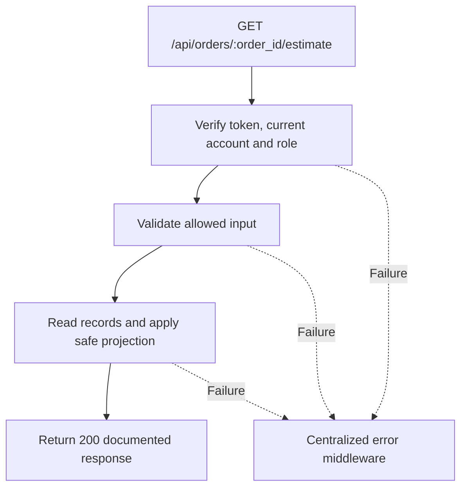

# Task BE-039: Read printable estimate data

**Endpoint**: `GET /api/orders/:order_id/estimate`

**Owner**: Member 3 · **Priority**: Must · **Requirement**: FR-EST-01

**Dependencies**: BE-031. Dependencies describe contracts and integration order; use fixtures to begin development before the corresponding endpoint is complete.

## 1. API Documentation

- **Method**: `GET`
- **URL**: `/api/orders/:order_id/estimate`
- **Access**: Manager or Admin
- **Authentication**: `Authorization: Bearer <access_token>`
- **Content-Type**: `application/json`
- **Path parameters**: `order_id` (positive integer)

### Request body

None. Do not send a JSON body.

### Success response (200)

```json
{
  "status": "success",
  "message": "Read printable estimate data successful",
  "data": {
    "order_id": 24,
    "document_type": "estimate",
    "estimate_number": "EST-24",
    "issued_at": "2026-10-25T12:00:00Z",
    "garage": {
      "settings_id": 1,
      "name": "Abe Garage",
      "address": "Addis Ababa",
      "phone": "0111234567",
      "email": "contact@abegarage.com",
      "vat_rate": "15.00"
    },
    "customer": {
      "first_name": "Sara",
      "last_name": "Tesfaye",
      "email": "sara@example.com",
      "phone": "0912345678"
    },
    "vehicle": {
      "vehicle_id": 8,
      "customer_id": 12,
      "year": 2020,
      "make": "Toyota",
      "model": "Corolla",
      "type": "Sedan",
      "mileage": 65000,
      "plate": "AA-12345",
      "vin": "JTDBR32E720123456",
      "color": "White"
    },
    "lines": [
      {
        "line_id": 41,
        "service_name": "Oil change",
        "description": "Replace engine oil and filter",
        "line_price": "50.00"
      },
      {
        "line_id": 42,
        "service_name": "Brake service",
        "description": "Inspect and service brakes",
        "line_price": "180.00"
      }
    ],
    "subtotal": "230.00",
    "vat_rate": "15.00",
    "vat_amount": "34.50",
    "total": "264.50",
    "currency": "ETB",
    "status": 1
  }
}
```

Examples use representative fixture records. Responses may have more/fewer array elements; fields and types are contractual. Nullable fields remain present as null. Where a task documents a restricted role projection, that projection replaces the general example for that role.

### Errors

- 400 Invalid input (unless this task specifies a different public-token rule)
- 401 Missing, invalid, expired or revoked access token
- 403 Inactive account or insufficient role
- 404 Order not found
- 500 Unexpected server error

Shared error format (field errors apply to validation failures):

```json
{
  "status": "error",
  "message": "Validation failed",
  "data": {
    "errors": {
      "email": "Enter a valid email address"
    }
  }
}
```

Non-validation errors use `data: null`, except explicitly documented safe metadata. See [shared conventions](../CONVENTIONS.md).

## 2. Instructions

1. Define route and middleware in `backend/src/api/orders/routes/order.route.js`.
2. Add `getEstimateValidation` in `backend/src/api/orders/validations/order.validation.js`.
3. Implement `getEstimateController` in `backend/src/api/orders/controller/order.controller.js`. Extract allowlisted inputs and verified actor context only.
4. Implement `getEstimateService` in `backend/src/api/orders/service/order.service.js`. Keep business rules and SQL out of controllers.
5. Share transactions, money/status helpers and notification adapter as described in foundation tasks; do not duplicate other modules’ logic.
6. On errors call `next(error)` from controller catches or use the shared async wrapper. Do not send competing error formats.

## 3. Logic & Git Instructions

### Logic steps

1. Return print-ready JSON, not a generated PDF. Frontend renders A4 and browser Print / Save as PDF.
2. Use current order line snapshots and stored totals/rate; never recalculate from current service prices. Label as estimate, not invoice.
3. Use current garage/customer/vehicle details prior to invoicing. For an issued invoice retain current estimate behavior but final invoice reads frozen snapshot. No internal notes,technician notes,hash or token in printable payload.
4. Get has no state-changing side effects. estimate_number is display-only EST-<order_id>, not a stored invoice identifier.

### Git workflow

```bash
git checkout dev
git pull --ff-only origin dev
git checkout -b codex/be-039-get-estimate
# Implement and run task-specific checks
git add <changed-files>
git commit -m "[BE-039] Read printable estimate data"
git push -u origin codex/be-039-get-estimate
```

Open a PR into dev with requirement IDs, examples and test evidence. One teammate reviews. Coordinate shared route registration through Member 1; module files belong to their listed owner.

### PR checklist and acceptance criteria

- [ ] Successful request returns 200 and exactly the documented safe response shape.
- [ ] Missing/expired/revoked token returns401; inactive account and unauthorized role return403.
- [ ] Verify 404 Order not found.
- [ ] Invalid/unknown input fields are rejected; no unexpected database changes occur on failure.
- [ ] GET has no data-changing side effects; list pagination/counts stay consistent.
- [ ] All errors go through centralized error middleware; no sensitive fields or stack traces escape.

## 4. Logic Diagram


