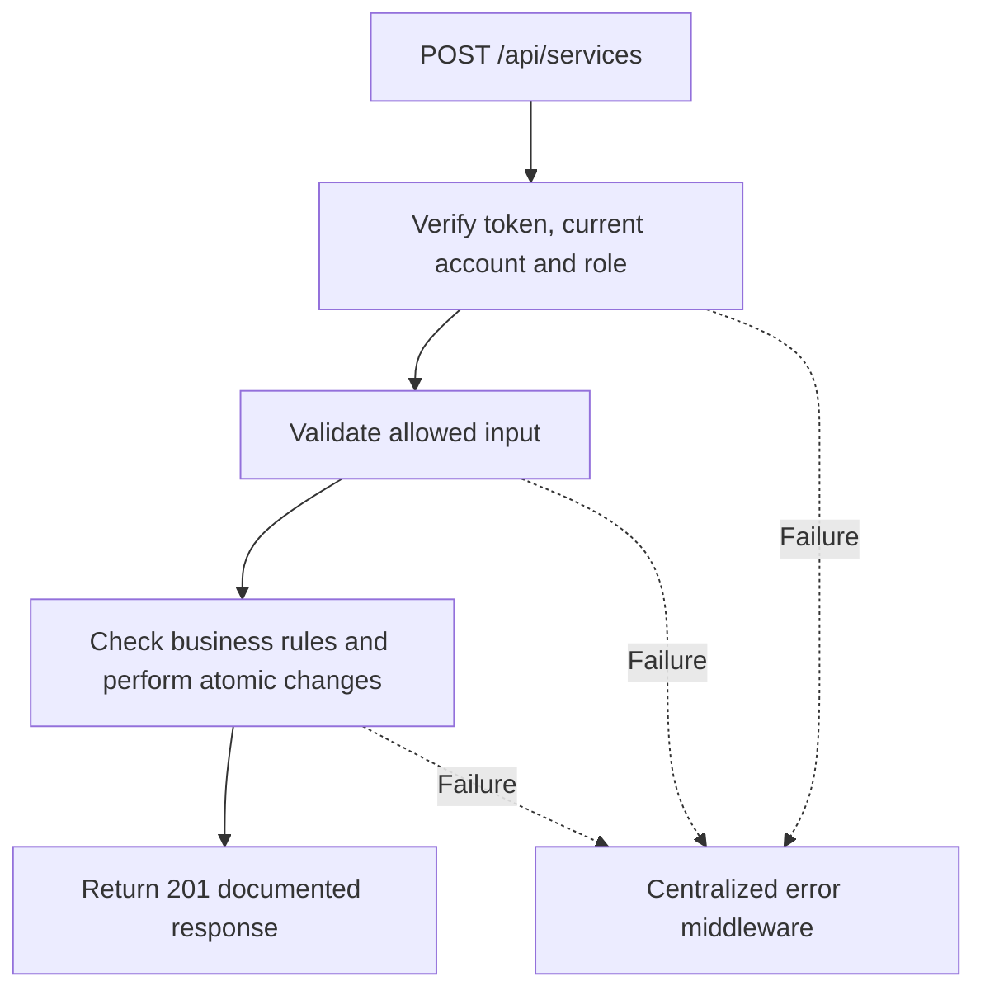

# Task BE-025: Create repair service

**Endpoint**: `POST /api/services`

**Owner**: Member 2 · **Priority**: Must · **Requirement**: FR-SRV-01

**Dependencies**: BE-003. Dependencies describe contracts and integration order; use fixtures to begin development before the corresponding endpoint is complete.

## 1. API Documentation

- **Method**: `POST`
- **URL**: `/api/services`
- **Access**: Admin
- **Authentication**: `Authorization: Bearer <access_token>`
- **Content-Type**: `application/json`

### Request body

```json
{
  "name": "Oil change",
  "description": "Replace engine oil and filter",
  "price": "50.00",
  "labor_hours": "0.50",
  "active": true
}
```

### Success response (201)

```json
{
  "status": "success",
  "message": "Create repair service successful",
  "data": {
    "service_id": 3,
    "name": "Oil change",
    "description": "Replace engine oil and filter",
    "price": "50.00",
    "labor_hours": "0.50",
    "active": true
  }
}
```

Examples use representative fixture records. Responses may have more/fewer array elements; fields and types are contractual. Nullable fields remain present as null. Where a task documents a restricted role projection, that projection replaces the general example for that role.

### Errors

- 400 Invalid input (unless this task specifies a different public-token rule)
- 401 Missing, invalid, expired or revoked access token
- 403 Inactive account or insufficient role
- 409 Service name already used
- 500 Unexpected server error

Shared error format (field errors apply to validation failures):

```json
{
  "status": "error",
  "message": "Validation failed",
  "data": {
    "errors": {
      "email": "Enter a valid email address"
    }
  }
}
```

Non-validation errors use `data: null`, except explicitly documented safe metadata. See [shared conventions](../CONVENTIONS.md).

## 2. Instructions

1. Define route and middleware in `backend/src/api/services/routes/service.route.js`.
2. Add `createServiceValidation` in `backend/src/api/services/validations/service.validation.js`.
3. Implement `createServiceController` in `backend/src/api/services/controller/service.controller.js`. Extract allowlisted inputs and verified actor context only.
4. Implement `createServiceService` in `backend/src/api/services/service/service.service.js`. Keep business rules and SQL out of controllers.
5. Share transactions, money/status helpers and notification adapter as described in foundation tasks; do not duplicate other modules’ logic.
6. On errors call `next(error)` from controller catches or use the shared async wrapper. Do not send competing error formats.

## 3. Logic & Git Instructions

### Logic steps

1. Validate unique trimmed name (1–150), description (1–2000), price as nonnegative decimal with at most 2 fractional digits, labor_hours as nonnegative decimal (2 fractional digits), active boolean.
2. Store price before VAT in DECIMAL, active defaults true. Return created service. Existing service names are unique as shown in the agreed ER diagram.

### Git workflow

```bash
git checkout dev
git pull --ff-only origin dev
git checkout -b codex/be-025-create-service
# Implement and run task-specific checks
git add <changed-files>
git commit -m "[BE-025] Create repair service"
git push -u origin codex/be-025-create-service
```

Open a PR into dev with requirement IDs, examples and test evidence. One teammate reviews. Coordinate shared route registration through Member 1; module files belong to their listed owner.

### PR checklist and acceptance criteria

- [ ] Successful request returns 201 and exactly the documented safe response shape.
- [ ] Missing/expired/revoked token returns401; inactive account and unauthorized role return403.
- [ ] Verify 409 Service name already used.
- [ ] Invalid/unknown input fields are rejected; no unexpected database changes occur on failure.
- [ ] Transaction/concurrency behavior and repeated-request behavior match the logic below.
- [ ] All errors go through centralized error middleware; no sensitive fields or stack traces escape.

## 4. Logic Diagram


