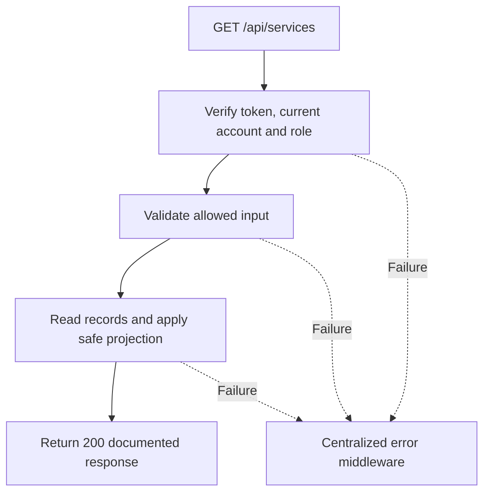

# Task BE-026: List staff service catalogue

**Endpoint**: `GET /api/services`

**Owner**: Member 2 · **Priority**: Must · **Requirement**: FR-SRV-01/02/03

**Dependencies**: BE-003. Dependencies describe contracts and integration order; use fixtures to begin development before the corresponding endpoint is complete.

## 1. API Documentation

- **Method**: `GET`
- **URL**: `/api/services`
- **Access**: Any active staff
- **Authentication**: `Authorization: Bearer <access_token>`
- **Content-Type**: `application/json`

### Request body

None. Do not send a JSON body.

### Query parameters example

```json
{
  "search": "oil",
  "active": true,
  "page": 1,
  "limit": 10
}
```

See [shared conventions](../CONVENTIONS.md) for types, limits and defaults. All filters are optional. Endpoint-specific behavior is described below.

### Success response (200)

```json
{
  "status": "success",
  "message": "List staff service catalogue successful",
  "data": {
    "services": [
      {
        "service_id": 3,
        "name": "Oil change",
        "description": "Replace engine oil and filter",
        "price": "50.00",
        "labor_hours": "0.50",
        "active": true
      }
    ],
    "pagination": {
      "page": 1,
      "limit": 10,
      "total": 1,
      "total_pages": 1
    }
  }
}
```

Examples use representative fixture records. Responses may have more/fewer array elements; fields and types are contractual. Nullable fields remain present as null. Where a task documents a restricted role projection, that projection replaces the general example for that role.

### Errors

- 400 Invalid input (unless this task specifies a different public-token rule)
- 401 Missing, invalid, expired or revoked access token
- 403 Inactive account or insufficient role
- 500 Unexpected server error

Shared error format (field errors apply to validation failures):

```json
{
  "status": "error",
  "message": "Validation failed",
  "data": {
    "errors": {
      "email": "Enter a valid email address"
    }
  }
}
```

Non-validation errors use `data: null`, except explicitly documented safe metadata. See [shared conventions](../CONVENTIONS.md).

## 2. Instructions

1. Define route and middleware in `backend/src/api/services/routes/service.route.js`.
2. Add `listServicesValidation` in `backend/src/api/services/validations/service.validation.js`.
3. Implement `listServicesController` in `backend/src/api/services/controller/service.controller.js`. Extract allowlisted inputs and verified actor context only.
4. Implement `listServicesService` in `backend/src/api/services/service/service.service.js`. Keep business rules and SQL out of controllers.
5. Share transactions, money/status helpers and notification adapter as described in foundation tasks; do not duplicate other modules’ logic.
6. On errors call `next(error)` from controller catches or use the shared async wrapper. Do not send competing error formats.

## 3. Logic & Git Instructions

### Logic steps

1. Support search on name/description and active filter. Include inactive by default for staff; order selection requests active=true.
2. Use pagination with default 10 and max 100; order name ASC,service_id ASC. Consumers needing every active item must request all pages, not assume page 1 is complete.

### Git workflow

```bash
git checkout dev
git pull --ff-only origin dev
git checkout -b codex/be-026-list-services
# Implement and run task-specific checks
git add <changed-files>
git commit -m "[BE-026] List staff service catalogue"
git push -u origin codex/be-026-list-services
```

Open a PR into dev with requirement IDs, examples and test evidence. One teammate reviews. Coordinate shared route registration through Member 1; module files belong to their listed owner.

### PR checklist and acceptance criteria

- [ ] Successful request returns 200 and exactly the documented safe response shape.
- [ ] Missing/expired/revoked token returns401; inactive account and unauthorized role return403.
- [ ] Invalid/unknown input fields are rejected; no unexpected database changes occur on failure.
- [ ] GET has no data-changing side effects; list pagination/counts stay consistent.
- [ ] All errors go through centralized error middleware; no sensitive fields or stack traces escape.

## 4. Logic Diagram


