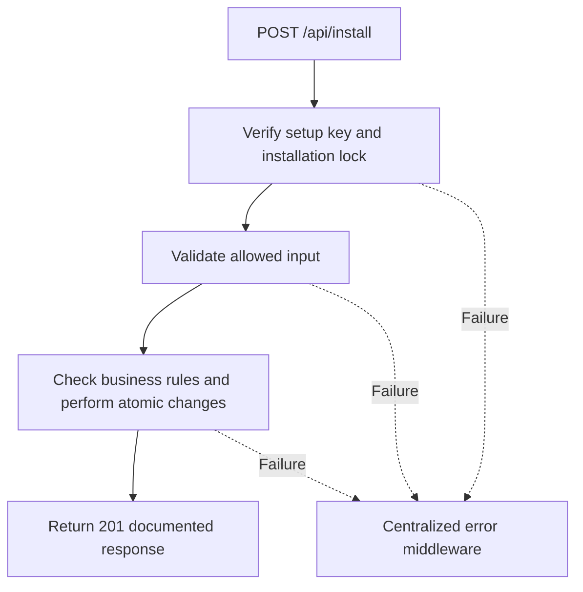

# Task BE-047: Initialize and lock installation

**Endpoint**: `POST /api/install`

**Owner**: Member 1 · **Priority**: Must; repeat safety Should · **Requirement**: FR-INS-01/02/03

**Dependencies**: BE-001, BE-002. Dependencies describe contracts and integration order; use fixtures to begin development before the corresponding endpoint is complete.

## 1. API Documentation

- **Method**: `POST`
- **URL**: `/api/install`
- **Access**: Deployment operator with setup secret; unavailable after setup
- **Authentication**: `X-Setup-Key: <setup-secret>`
- **Content-Type**: `application/json`

### Request body

None. Do not send a JSON body.

### Success response (201)

```json
{
  "status": "success",
  "message": "Initialize and lock installation successful",
  "data": {
    "installed": true,
    "roles_created": 3,
    "admin_created": true
  }
}
```

Examples use representative fixture records. Responses may have more/fewer array elements; fields and types are contractual. Nullable fields remain present as null. Where a task documents a restricted role projection, that projection replaces the general example for that role.

### Errors

- 400 Invalid input (unless this task specifies a different public-token rule)
- 403 Setup access denied or installation is locked
- 503 Installation currently running
- 500 Unexpected server error

Shared error format (field errors apply to validation failures):

```json
{
  "status": "error",
  "message": "Validation failed",
  "data": {
    "errors": {
      "email": "Enter a valid email address"
    }
  }
}
```

Non-validation errors use `data: null`, except explicitly documented safe metadata. See [shared conventions](../CONVENTIONS.md).

## 2. Instructions

1. Define route and middleware in `backend/src/api/setup/routes/setup.route.js`.
2. Add `installValidation` in `backend/src/api/setup/validations/setup.validation.js`.
3. Implement `installController` in `backend/src/api/setup/controller/setup.controller.js`. Extract allowlisted inputs and verified actor context only.
4. Implement `installService` in `backend/src/api/setup/service/setup.service.js`. Keep business rules and SQL out of controllers.
5. Share transactions, money/status helpers and notification adapter as described in foundation tasks; do not duplicate other modules’ logic.
6. On errors call `next(error)` from controller catches or use the shared async wrapper. Do not send competing error formats.

## 3. Logic & Git Instructions

### Logic steps

1. Changed from document GET /install to POST /api/install because initialization changes state. Prefer running migrations/seed CLI in production; if HTTP setup is enabled require X-Setup-Key matching env-only INSTALL_SECRET.
2. Admin email/name/password and initial settings come from deployment environment, not public request. Enforce password policy and never return credentials.
3. Use migration ledger/setup metadata plus database advisory lock to serialize installation. MySQL DDL implicitly commits: do NOT claim CREATE TABLE migrations roll back with seed inserts. Apply idempotent migrations first; seed rows transactionally with unique role IDs/admin email.
4. Set installed marker only when migrations and seed complete; persist across restarts. Successful setup returns201. Later HTTP requests return403 Installation is locked. Internal migration/seed reruns are idempotent; disabled install returns404.
5. Concurrent installer cannot create duplicate admin/roles. Missing/incorrect setup key returns403 without touching schema. Keep /api/health usable before setup.

### Git workflow

```bash
git checkout dev
git pull --ff-only origin dev
git checkout -b codex/be-047-install
# Implement and run task-specific checks
git add <changed-files>
git commit -m "[BE-047] Initialize and lock installation"
git push -u origin codex/be-047-install
```

Open a PR into dev with requirement IDs, examples and test evidence. One teammate reviews. Coordinate shared route registration through Member 1; module files belong to their listed owner.

### PR checklist and acceptance criteria

- [ ] Successful request returns 201 and exactly the documented safe response shape.
- [ ] Wrong key, repeated setup and concurrent setup behave as specified.
- [ ] Verify 403 Setup access denied or installation is locked.
- [ ] Verify 503 Installation currently running.
- [ ] Invalid/unknown input fields are rejected; no unexpected database changes occur on failure.
- [ ] Transaction/concurrency behavior and repeated-request behavior match the logic below.
- [ ] All errors go through centralized error middleware; no sensitive fields or stack traces escape.

## 4. Logic Diagram


