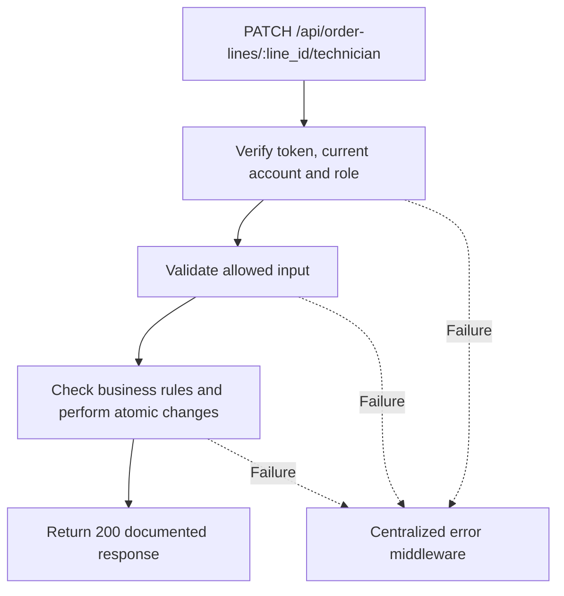

# Task BE-035: Assign technician to job line

**Endpoint**: `PATCH /api/order-lines/:line_id/technician`

**Owner**: Member 2 · **Priority**: Must · **Requirement**: FR-TEC-01

**Dependencies**: BE-003, BE-029. Dependencies describe contracts and integration order; use fixtures to begin development before the corresponding endpoint is complete.

## 1. API Documentation

- **Method**: `PATCH`
- **URL**: `/api/order-lines/:line_id/technician`
- **Access**: Manager or Admin
- **Authentication**: `Authorization: Bearer <access_token>`
- **Content-Type**: `application/json`
- **Path parameters**: `line_id` (positive integer)

### Request body

```json
{
  "technician_id": 5
}
```

### Success response (200)

```json
{
  "status": "success",
  "message": "Assign technician to job line successful",
  "data": {
    "line_id": 41,
    "order_id": 24,
    "technician_id": 5,
    "technician_name": "Abebe Kebede"
  }
}
```

Examples use representative fixture records. Responses may have more/fewer array elements; fields and types are contractual. Nullable fields remain present as null. Where a task documents a restricted role projection, that projection replaces the general example for that role.

### Errors

- 400 Invalid input (unless this task specifies a different public-token rule)
- 401 Missing, invalid, expired or revoked access token
- 403 Inactive account or insufficient role
- 404 Job line or employee not found
- 409 Employee is not an active Technician
- 409 Job or order is closed
- 500 Unexpected server error

Shared error format (field errors apply to validation failures):

```json
{
  "status": "error",
  "message": "Validation failed",
  "data": {
    "errors": {
      "email": "Enter a valid email address"
    }
  }
}
```

Non-validation errors use `data: null`, except explicitly documented safe metadata. See [shared conventions](../CONVENTIONS.md).

## 2. Instructions

1. Define route and middleware in `backend/src/api/technician-jobs/routes/technician-job.route.js`.
2. Add `assignTechnicianValidation` in `backend/src/api/technician-jobs/validations/technician-job.validation.js`.
3. Implement `assignTechnicianController` in `backend/src/api/technician-jobs/controller/technician-job.controller.js`. Extract allowlisted inputs and verified actor context only.
4. Implement `assignTechnicianService` in `backend/src/api/technician-jobs/service/technician-job.service.js`. Keep business rules and SQL out of controllers.
5. Share transactions, money/status helpers and notification adapter as described in foundation tasks; do not duplicate other modules’ logic.
6. On errors call `next(error)` from controller catches or use the shared async wrapper. Do not send competing error formats.

## 3. Logic & Git Instructions

### Logic steps

1. Resolve parent order, lock parent order first and then line. Verify active employee with role_id=1; arbitrary Manager/Admin accounts are not assignment candidates.
2. Allow assignment/reassignment on status 1/2/3 for not-started or started lines; reject completed lines and terminal orders. Technician_id must be a positive integer; no unassign action in this release.
3. Lock/check candidate employee while saving so deactivation cannot race assignment. Reassigning a started line preserves its progress and records old/new technician in history.
4. Preserve state rules in shared order-domain service owned by Member 3. Reassigning the same technician is a successful no-op without duplicate history.

### Git workflow

```bash
git checkout dev
git pull --ff-only origin dev
git checkout -b codex/be-035-assign-technician
# Implement and run task-specific checks
git add <changed-files>
git commit -m "[BE-035] Assign technician to job line"
git push -u origin codex/be-035-assign-technician
```

Open a PR into dev with requirement IDs, examples and test evidence. One teammate reviews. Coordinate shared route registration through Member 1; module files belong to their listed owner.

### PR checklist and acceptance criteria

- [ ] Successful request returns 200 and exactly the documented safe response shape.
- [ ] Missing/expired/revoked token returns401; inactive account and unauthorized role return403.
- [ ] Verify 404 Job line or employee not found.
- [ ] Verify 409 Employee is not an active Technician.
- [ ] Verify 409 Job or order is closed.
- [ ] Invalid/unknown input fields are rejected; no unexpected database changes occur on failure.
- [ ] Transaction/concurrency behavior and repeated-request behavior match the logic below.
- [ ] All errors go through centralized error middleware; no sensitive fields or stack traces escape.

## 4. Logic Diagram


