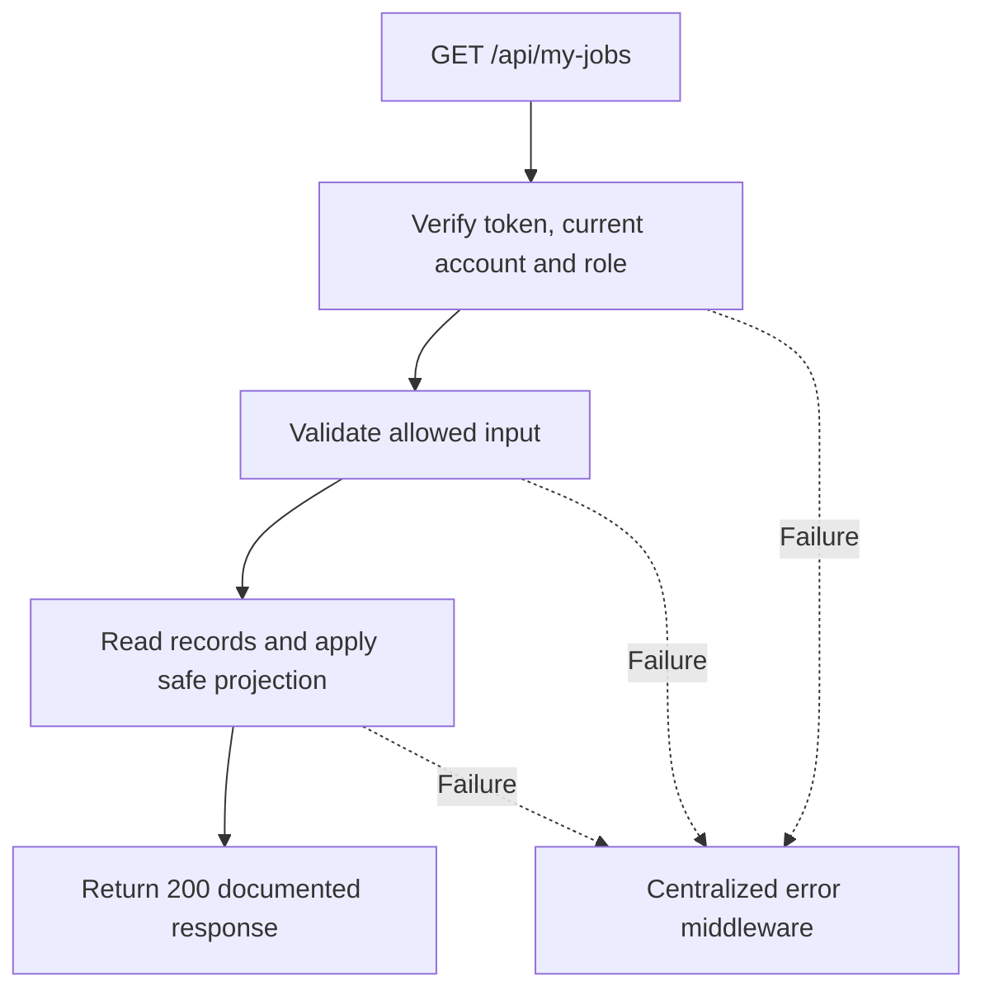

# Task BE-036: List my technician jobs

**Endpoint**: `GET /api/my-jobs`

**Owner**: Member 2 · **Priority**: Must · **Requirement**: FR-TEC-02

**Dependencies**: BE-035. Dependencies describe contracts and integration order; use fixtures to begin development before the corresponding endpoint is complete.

## 1. API Documentation

- **Method**: `GET`
- **URL**: `/api/my-jobs`
- **Access**: Technician only
- **Authentication**: `Authorization: Bearer <access_token>`
- **Content-Type**: `application/json`

### Request body

None. Do not send a JSON body.

### Query parameters example

```json
{
  "line_status": 0,
  "page": 1,
  "limit": 10
}
```

See [shared conventions](../CONVENTIONS.md) for types, limits and defaults. All filters are optional. Endpoint-specific behavior is described below.

### Success response (200)

```json
{
  "status": "success",
  "message": "List my technician jobs successful",
  "data": {
    "jobs": [
      {
        "line_id": 41,
        "order_id": 24,
        "service_id": 3,
        "service_name": "Oil change",
        "service_description": "Replace engine oil and filter",
        "labor_hours": "0.50",
        "line_price": "50.00",
        "technician_id": 5,
        "technician_name": "Abebe Kebede",
        "line_status": 0,
        "started_at": null,
        "done_at": null,
        "technician_note": null,
        "order_status": 2,
        "customer_name": "Sara Tesfaye",
        "vehicle": {
          "make": "Toyota",
          "model": "Corolla",
          "plate": "AA-12345"
        },
        "estimated_ready_date": "2026-10-27T09:00:00Z"
      }
    ],
    "pagination": {
      "page": 1,
      "limit": 10,
      "total": 1,
      "total_pages": 1
    }
  }
}
```

Examples use representative fixture records. Responses may have more/fewer array elements; fields and types are contractual. Nullable fields remain present as null. Where a task documents a restricted role projection, that projection replaces the general example for that role.

### Errors

- 400 Invalid input (unless this task specifies a different public-token rule)
- 401 Missing, invalid, expired or revoked access token
- 403 Inactive account or insufficient role
- 500 Unexpected server error

Shared error format (field errors apply to validation failures):

```json
{
  "status": "error",
  "message": "Validation failed",
  "data": {
    "errors": {
      "email": "Enter a valid email address"
    }
  }
}
```

Non-validation errors use `data: null`, except explicitly documented safe metadata. See [shared conventions](../CONVENTIONS.md).

## 2. Instructions

1. Define route and middleware in `backend/src/api/technician-jobs/routes/technician-job.route.js`.
2. Add `myJobsValidation` in `backend/src/api/technician-jobs/validations/technician-job.validation.js`.
3. Implement `myJobsController` in `backend/src/api/technician-jobs/controller/technician-job.controller.js`. Extract allowlisted inputs and verified actor context only.
4. Implement `myJobsService` in `backend/src/api/technician-jobs/service/technician-job.service.js`. Keep business rules and SQL out of controllers.
5. Share transactions, money/status helpers and notification adapter as described in foundation tasks; do not duplicate other modules’ logic.
6. On errors call `next(error)` from controller catches or use the shared async wrapper. Do not send competing error formats.

## 3. Logic & Git Instructions

### Logic steps

1. Take technician ID exclusively from token; clients cannot request another technician_id.
2. Return assigned lines whose orders have approved work scope (status 2/3/4); optional line_status=0|1|2 filters. Hide status 1 awaiting/reapproval and status 5 declined orders.
3. Sort parent order created_at DESC,order_id DESC,line_id DESC. Include vehicle and readiness info, not customer contact/internal notes. Use shared pagination.

### Git workflow

```bash
git checkout dev
git pull --ff-only origin dev
git checkout -b codex/be-036-my-jobs
# Implement and run task-specific checks
git add <changed-files>
git commit -m "[BE-036] List my technician jobs"
git push -u origin codex/be-036-my-jobs
```

Open a PR into dev with requirement IDs, examples and test evidence. One teammate reviews. Coordinate shared route registration through Member 1; module files belong to their listed owner.

### PR checklist and acceptance criteria

- [ ] Successful request returns 200 and exactly the documented safe response shape.
- [ ] Missing/expired/revoked token returns401; inactive account and unauthorized role return403.
- [ ] Invalid/unknown input fields are rejected; no unexpected database changes occur on failure.
- [ ] GET has no data-changing side effects; list pagination/counts stay consistent.
- [ ] All errors go through centralized error middleware; no sensitive fields or stack traces escape.

## 4. Logic Diagram


