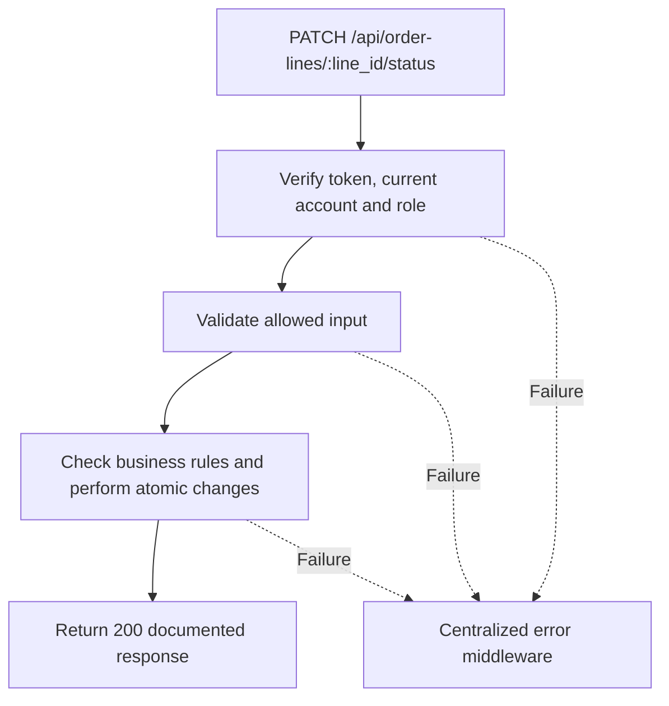

# Task BE-037: Start or finish technician job

**Endpoint**: `PATCH /api/order-lines/:line_id/status`

**Owner**: Member 2 · **Priority**: Must · **Requirement**: FR-TEC-03/04

**Dependencies**: BE-035, BE-033, BE-043. Dependencies describe contracts and integration order; use fixtures to begin development before the corresponding endpoint is complete.

## 1. API Documentation

- **Method**: `PATCH`
- **URL**: `/api/order-lines/:line_id/status`
- **Access**: Assigned Technician; Manager or Admin
- **Authentication**: `Authorization: Bearer <access_token>`
- **Content-Type**: `application/json`
- **Path parameters**: `line_id` (positive integer)

### Request body

```json
{
  "line_status": 1
}
```

### Success response (200)

```json
{
  "status": "success",
  "message": "Start or finish technician job successful",
  "data": {
    "line_id": 41,
    "line_status": 1,
    "started_at": "2026-10-25T12:00:00Z",
    "done_at": null,
    "order_id": 24,
    "order_status": 3,
    "order_status_name": "In progress"
  }
}
```

Examples use representative fixture records. Responses may have more/fewer array elements; fields and types are contractual. Nullable fields remain present as null. Where a task documents a restricted role projection, that projection replaces the general example for that role.

### Errors

- 400 Invalid input (unless this task specifies a different public-token rule)
- 401 Missing, invalid, expired or revoked access token
- 403 Inactive account or insufficient role
- 404 Job line not found
- 403 Job is assigned to another Technician
- 409 Invalid transition or approval is required
- 409 Assigned technician is inactive
- 500 Unexpected server error

Shared error format (field errors apply to validation failures):

```json
{
  "status": "error",
  "message": "Validation failed",
  "data": {
    "errors": {
      "email": "Enter a valid email address"
    }
  }
}
```

Non-validation errors use `data: null`, except explicitly documented safe metadata. See [shared conventions](../CONVENTIONS.md).

## 2. Instructions

1. Define route and middleware in `backend/src/api/technician-jobs/routes/technician-job.route.js`.
2. Add `updateJobStatusValidation` in `backend/src/api/technician-jobs/validations/technician-job.validation.js`.
3. Implement `updateJobStatusController` in `backend/src/api/technician-jobs/controller/technician-job.controller.js`. Extract allowlisted inputs and verified actor context only.
4. Implement `updateJobStatusService` in `backend/src/api/technician-jobs/service/technician-job.service.js`. Keep business rules and SQL out of controllers.
5. Share transactions, money/status helpers and notification adapter as described in foundation tasks; do not duplicate other modules’ logic.
6. On errors call `next(error)` from controller catches or use the shared async wrapper. Do not send competing error formats.

## 3. Logic & Git Instructions

### Logic steps

1. Resolve line then lock parent order first and target line on same transaction connection; authenticate assignment again after locks. Another Technician gets403; Manager/Admin may progress any valid assigned line.
2. Require approved scope for new transitions (order status2/3). Permit only 0→1→2; no skipping or backward transitions. Exact repeated status is a successful no-op on approved/in-progress/completed orders, retaining original timestamps and no new history. Awaiting-reapproval and declined orders still reject409.
3. First start sets started_at and parent status3; finishing sets done_at. Require active assigned Technician for unfinished work; otherwise Manager must reassign first.
4. After update recompute parent from all lines under parent lock: any started/done but not all done →3; all done →4 and completed_at set once. Write history with actor/time.
5. Only transaction that changes parent to4 schedules car_ready email after commit via shared adapter; delivery failures leave completion intact and are recorded in history.

### Git workflow

```bash
git checkout dev
git pull --ff-only origin dev
git checkout -b codex/be-037-update-job-status
# Implement and run task-specific checks
git add <changed-files>
git commit -m "[BE-037] Start or finish technician job"
git push -u origin codex/be-037-update-job-status
```

Open a PR into dev with requirement IDs, examples and test evidence. One teammate reviews. Coordinate shared route registration through Member 1; module files belong to their listed owner.

### PR checklist and acceptance criteria

- [ ] Successful request returns 200 and exactly the documented safe response shape.
- [ ] Run two final-job completions concurrently; order completes once and only one readiness notification is scheduled.
- [ ] Missing/expired/revoked token returns401; inactive account and unauthorized role return403.
- [ ] Verify 404 Job line not found.
- [ ] Verify 403 Job is assigned to another Technician.
- [ ] Verify 409 Invalid transition or approval is required.
- [ ] Verify 409 Assigned technician is inactive.
- [ ] Invalid/unknown input fields are rejected; no unexpected database changes occur on failure.
- [ ] Transaction/concurrency behavior and repeated-request behavior match the logic below.
- [ ] All errors go through centralized error middleware; no sensitive fields or stack traces escape.

## 4. Logic Diagram


