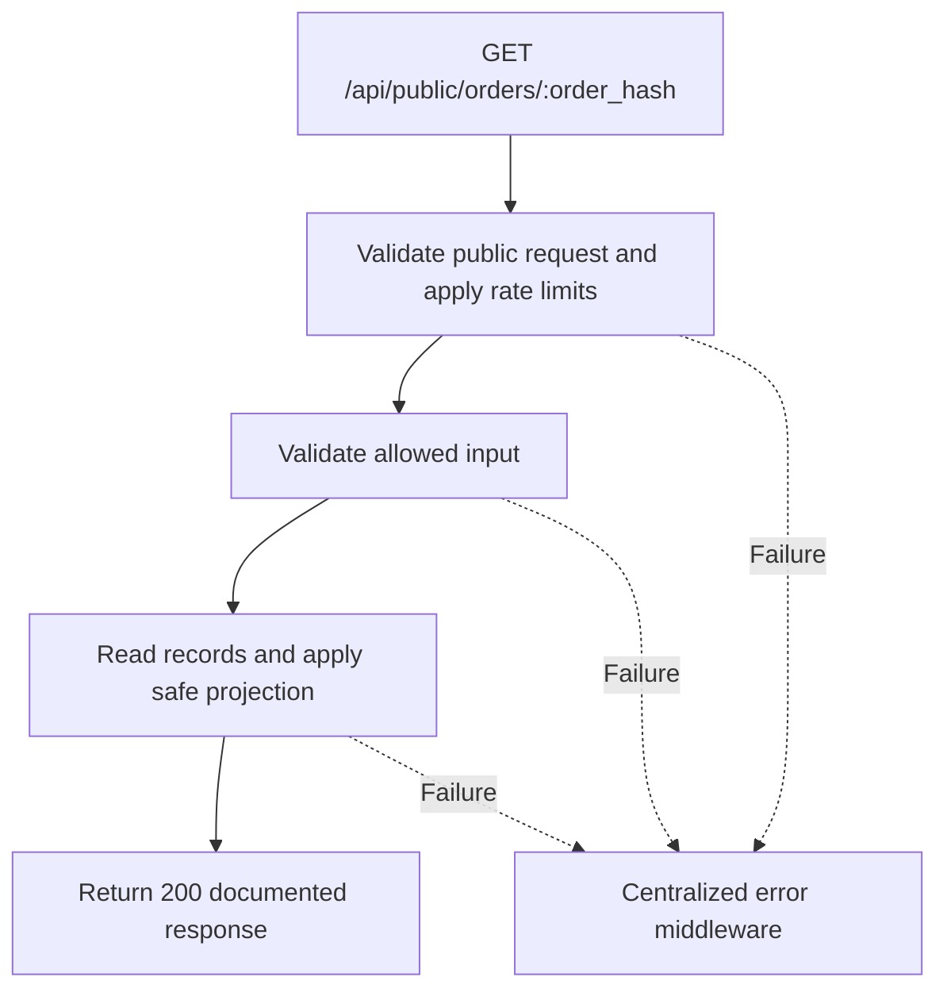

# Task BE-044: Read private-link customer order status

**Endpoint**: `GET /api/public/orders/:order_hash`

**Owner**: Member 4 · **Priority**: Must · **Requirement**: FR-TRK-02/03

**Dependencies**: BE-003. Dependencies describe contracts and integration order; use fixtures to begin development before the corresponding endpoint is complete.

## 1. API Documentation

- **Method**: `GET`
- **URL**: `/api/public/orders/:order_hash`
- **Access**: Public with valid unguessable order hash
- **Authentication**: `None`
- **Content-Type**: `application/json`
- **Path parameters**: `order_hash` (64-character hexadecimal secret)

### Request body

None. Do not send a JSON body.

### Success response (200)

```json
{
  "status": "success",
  "message": "Read private-link customer order status successful",
  "data": {
    "order_id": 24,
    "vehicle": {
      "year": 2020,
      "make": "Toyota",
      "model": "Corolla",
      "color": "White",
      "plate": "AA-12345"
    },
    "status": 3,
    "status_name": "In progress",
    "estimated_ready_date": "2026-10-27T09:00:00Z",
    "notes_for_customer": "Please call before collection.",
    "jobs": [
      {
        "service_name": "Oil change",
        "line_status": 1
      },
      {
        "service_name": "Brake service",
        "line_status": 0
      }
    ],
    "subtotal": "230.00",
    "vat_rate": "15.00",
    "vat_amount": "34.50",
    "total": "264.50",
    "currency": "ETB",
    "paid": false
  }
}
```

Examples use representative fixture records. Responses may have more/fewer array elements; fields and types are contractual. Nullable fields remain present as null. Where a task documents a restricted role projection, that projection replaces the general example for that role.

### Errors

- 400 Invalid input (unless this task specifies a different public-token rule)
- 404 Order not found
- 429 Too many requests
- 500 Unexpected server error

Shared error format (field errors apply to validation failures):

```json
{
  "status": "error",
  "message": "Validation failed",
  "data": {
    "errors": {
      "email": "Enter a valid email address"
    }
  }
}
```

Non-validation errors use `data: null`, except explicitly documented safe metadata. See [shared conventions](../CONVENTIONS.md).

## 2. Instructions

1. Define route and middleware in `backend/src/api/tracking/routes/tracking.route.js`.
2. Add `publicOrderStatusValidation` in `backend/src/api/tracking/validations/tracking.validation.js`.
3. Implement `publicOrderStatusController` in `backend/src/api/tracking/controller/tracking.controller.js`. Extract allowlisted inputs and verified actor context only.
4. Implement `publicOrderStatusService` in `backend/src/api/tracking/service/tracking.service.js`. Keep business rules and SQL out of controllers.
5. Share transactions, money/status helpers and notification adapter as described in foundation tasks; do not duplicate other modules’ logic.
6. On errors call `next(error)` from controller catches or use the shared async wrapper. Do not send competing error formats.

## 3. Logic & Git Instructions

### Logic steps

1. Hash format is64 lowercase hex characters (32 random bytes). Malformed or unknown hashes both return404 Order not found, without a distinguishable validation response.
2. Explicitly select only fields in example. Never return customer names,email,phone,VIN,internal_notes,technician notes/identities,history,staff information or other orders.
3. Treat URL as a bearer secret: HTTPS,Cache-Control:no-store,Referrer-Policy:no-referrer and sanitized access logs; rate-limit lookup attempts. No public approve/decline or payment mutation.
4. Frontend /order-status/:hash and optional code-entry box call this same API; no separate check-code endpoint required.

### Git workflow

```bash
git checkout dev
git pull --ff-only origin dev
git checkout -b codex/be-044-public-order-status
# Implement and run task-specific checks
git add <changed-files>
git commit -m "[BE-044] Read private-link customer order status"
git push -u origin codex/be-044-public-order-status
```

Open a PR into dev with requirement IDs, examples and test evidence. One teammate reviews. Coordinate shared route registration through Member 1; module files belong to their listed owner.

### PR checklist and acceptance criteria

- [ ] Successful request returns 200 and exactly the documented safe response shape.
- [ ] Works without staff login; applies documented rate limits and public-field restrictions.
- [ ] Verify 404 Order not found.
- [ ] Verify 429 Too many requests.
- [ ] Invalid/unknown input fields are rejected; no unexpected database changes occur on failure.
- [ ] GET has no data-changing side effects; list pagination/counts stay consistent.
- [ ] All errors go through centralized error middleware; no sensitive fields or stack traces escape.

## 4. Logic Diagram


