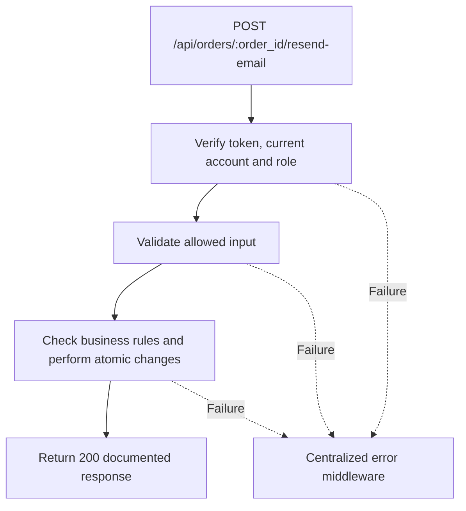

# Task BE-045: Resend order tracking email

**Endpoint**: `POST /api/orders/:order_id/resend-email`

**Owner**: Member 4 · **Priority**: Should · **Requirement**: FR-TRK-07

**Dependencies**: BE-043, BE-029. Dependencies describe contracts and integration order; use fixtures to begin development before the corresponding endpoint is complete.

## 1. API Documentation

- **Method**: `POST`
- **URL**: `/api/orders/:order_id/resend-email`
- **Access**: Manager or Admin
- **Authentication**: `Authorization: Bearer <access_token>`
- **Content-Type**: `application/json`
- **Path parameters**: `order_id` (positive integer)

### Request body

None. Do not send a JSON body.

### Success response (200)

```json
{
  "status": "success",
  "message": "Resend order tracking email successful",
  "data": {
    "order_id": 24,
    "email_status": "sent"
  }
}
```

Examples use representative fixture records. Responses may have more/fewer array elements; fields and types are contractual. Nullable fields remain present as null. Where a task documents a restricted role projection, that projection replaces the general example for that role.

### Errors

- 400 Invalid input (unless this task specifies a different public-token rule)
- 401 Missing, invalid, expired or revoked access token
- 403 Inactive account or insufficient role
- 404 Order not found
- 429 Too many resend attempts
- 503 Email could not be sent
- 500 Unexpected server error

Shared error format (field errors apply to validation failures):

```json
{
  "status": "error",
  "message": "Validation failed",
  "data": {
    "errors": {
      "email": "Enter a valid email address"
    }
  }
}
```

Non-validation errors use `data: null`, except explicitly documented safe metadata. See [shared conventions](../CONVENTIONS.md).

## 2. Instructions

1. Define route and middleware in `backend/src/api/tracking/routes/tracking.route.js`.
2. Add `resendStatusEmailValidation` in `backend/src/api/tracking/validations/tracking.validation.js`.
3. Implement `resendStatusEmailController` in `backend/src/api/tracking/controller/tracking.controller.js`. Extract allowlisted inputs and verified actor context only.
4. Implement `resendStatusEmailService` in `backend/src/api/tracking/service/tracking.service.js`. Keep business rules and SQL out of controllers.
5. Share transactions, money/status helpers and notification adapter as described in foundation tasks; do not duplicate other modules’ logic.
6. On errors call `next(error)` from controller catches or use the shared async wrapper. Do not send competing error formats.

## 3. Logic & Git Instructions

### Logic steps

1. Verify order and customer email. Rate-limit by order and caller; require active caller but historical order can be viewed/emailed even when customer record is inactive.
2. Call shared mail adapter using current customer email; completed order uses car_ready template, others use tracking template. Tracking URL uses fixed FRONTEND_URL and stored hash.
3. Log delivery result in order_history without raw link/token. Successful SMTP acceptance returns200 with email_status=sent; it is not proof of inbox delivery.
4. Delivery failure returns503 through centralized error middleware with generic message and safe data {order_id,email_status:"failed"}; order remains saved. Automatic creation/completion emails instead swallow adapter failure after recording it.

### Git workflow

```bash
git checkout dev
git pull --ff-only origin dev
git checkout -b codex/be-045-resend-status-email
# Implement and run task-specific checks
git add <changed-files>
git commit -m "[BE-045] Resend order tracking email"
git push -u origin codex/be-045-resend-status-email
```

Open a PR into dev with requirement IDs, examples and test evidence. One teammate reviews. Coordinate shared route registration through Member 1; module files belong to their listed owner.

### PR checklist and acceptance criteria

- [ ] Successful request returns 200 and exactly the documented safe response shape.
- [ ] Missing/expired/revoked token returns401; inactive account and unauthorized role return403.
- [ ] Verify 404 Order not found.
- [ ] Verify 429 Too many resend attempts.
- [ ] Verify 503 Email could not be sent.
- [ ] Invalid/unknown input fields are rejected; no unexpected database changes occur on failure.
- [ ] Transaction/concurrency behavior and repeated-request behavior match the logic below.
- [ ] All errors go through centralized error middleware; no sensitive fields or stack traces escape.

## 4. Logic Diagram


