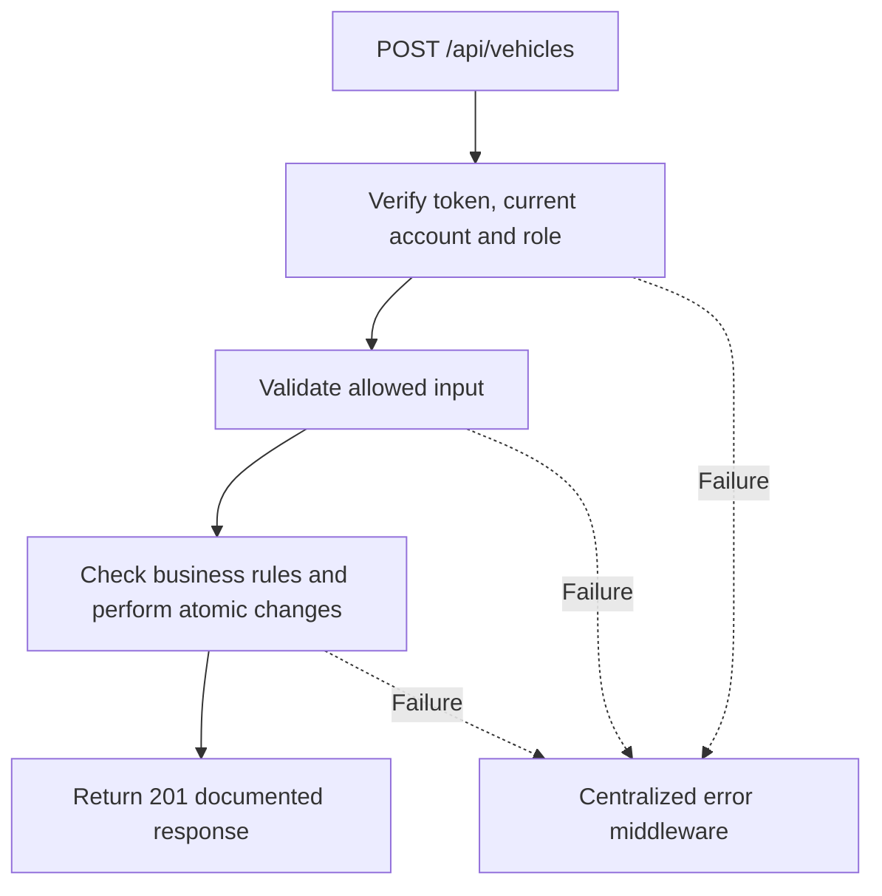

# Task BE-020: Add vehicle to customer

**Endpoint**: `POST /api/vehicles`

**Owner**: Member 2 · **Priority**: Must · **Requirement**: FR-VEH-01

**Dependencies**: BE-016. Dependencies describe contracts and integration order; use fixtures to begin development before the corresponding endpoint is complete.

## 1. API Documentation

- **Method**: `POST`
- **URL**: `/api/vehicles`
- **Access**: Manager or Admin
- **Authentication**: `Authorization: Bearer <access_token>`
- **Content-Type**: `application/json`

### Request body

```json
{
  "customer_id": 12,
  "year": 2020,
  "make": "Toyota",
  "model": "Corolla",
  "type": "Sedan",
  "mileage": 65000,
  "plate": "AA-12345",
  "vin": "JTDBR32E720123456",
  "color": "White"
}
```

### Success response (201)

```json
{
  "status": "success",
  "message": "Add vehicle to customer successful",
  "data": {
    "vehicle_id": 8,
    "customer_id": 12,
    "year": 2020,
    "make": "Toyota",
    "model": "Corolla",
    "type": "Sedan",
    "mileage": 65000,
    "plate": "AA-12345",
    "vin": "JTDBR32E720123456",
    "color": "White"
  }
}
```

Examples use representative fixture records. Responses may have more/fewer array elements; fields and types are contractual. Nullable fields remain present as null. Where a task documents a restricted role projection, that projection replaces the general example for that role.

### Errors

- 400 Invalid input (unless this task specifies a different public-token rule)
- 401 Missing, invalid, expired or revoked access token
- 403 Inactive account or insufficient role
- 404 Customer not found
- 409 Customer is inactive
- 409 Plate already used
- 500 Unexpected server error

Shared error format (field errors apply to validation failures):

```json
{
  "status": "error",
  "message": "Validation failed",
  "data": {
    "errors": {
      "email": "Enter a valid email address"
    }
  }
}
```

Non-validation errors use `data: null`, except explicitly documented safe metadata. See [shared conventions](../CONVENTIONS.md).

## 2. Instructions

1. Define route and middleware in `backend/src/api/vehicles/routes/vehicle.route.js`.
2. Add `createVehicleValidation` in `backend/src/api/vehicles/validations/vehicle.validation.js`.
3. Implement `createVehicleController` in `backend/src/api/vehicles/controller/vehicle.controller.js`. Extract allowlisted inputs and verified actor context only.
4. Implement `createVehicleService` in `backend/src/api/vehicles/service/vehicle.service.js`. Keep business rules and SQL out of controllers.
5. Share transactions, money/status helpers and notification adapter as described in foundation tasks; do not duplicate other modules’ logic.
6. On errors call `next(error)` from controller catches or use the shared async wrapper. Do not send competing error formats.

## 3. Logic & Git Instructions

### Logic steps

1. Validate customer_id, year 1886 through current year+1, nonempty make/model/type/plate/color, and nonnegative integer mileage. VIN is optional, at most 32 characters; do not impose a universal VIN length on older vehicles.
2. Verify active customer. Normalize plate (trim/uppercase) and enforce uniqueness; VIN is not UNIQUE in this release.
3. Insert with customer foreign key; return 404 for missing customer, 409 for inactive customer or duplicate plate.

### Git workflow

```bash
git checkout dev
git pull --ff-only origin dev
git checkout -b codex/be-020-create-vehicle
# Implement and run task-specific checks
git add <changed-files>
git commit -m "[BE-020] Add vehicle to customer"
git push -u origin codex/be-020-create-vehicle
```

Open a PR into dev with requirement IDs, examples and test evidence. One teammate reviews. Coordinate shared route registration through Member 1; module files belong to their listed owner.

### PR checklist and acceptance criteria

- [ ] Successful request returns 201 and exactly the documented safe response shape.
- [ ] Missing/expired/revoked token returns401; inactive account and unauthorized role return403.
- [ ] Verify 404 Customer not found.
- [ ] Verify 409 Customer is inactive.
- [ ] Verify 409 Plate already used.
- [ ] Invalid/unknown input fields are rejected; no unexpected database changes occur on failure.
- [ ] Transaction/concurrency behavior and repeated-request behavior match the logic below.
- [ ] All errors go through centralized error middleware; no sensitive fields or stack traces escape.

## 4. Logic Diagram


