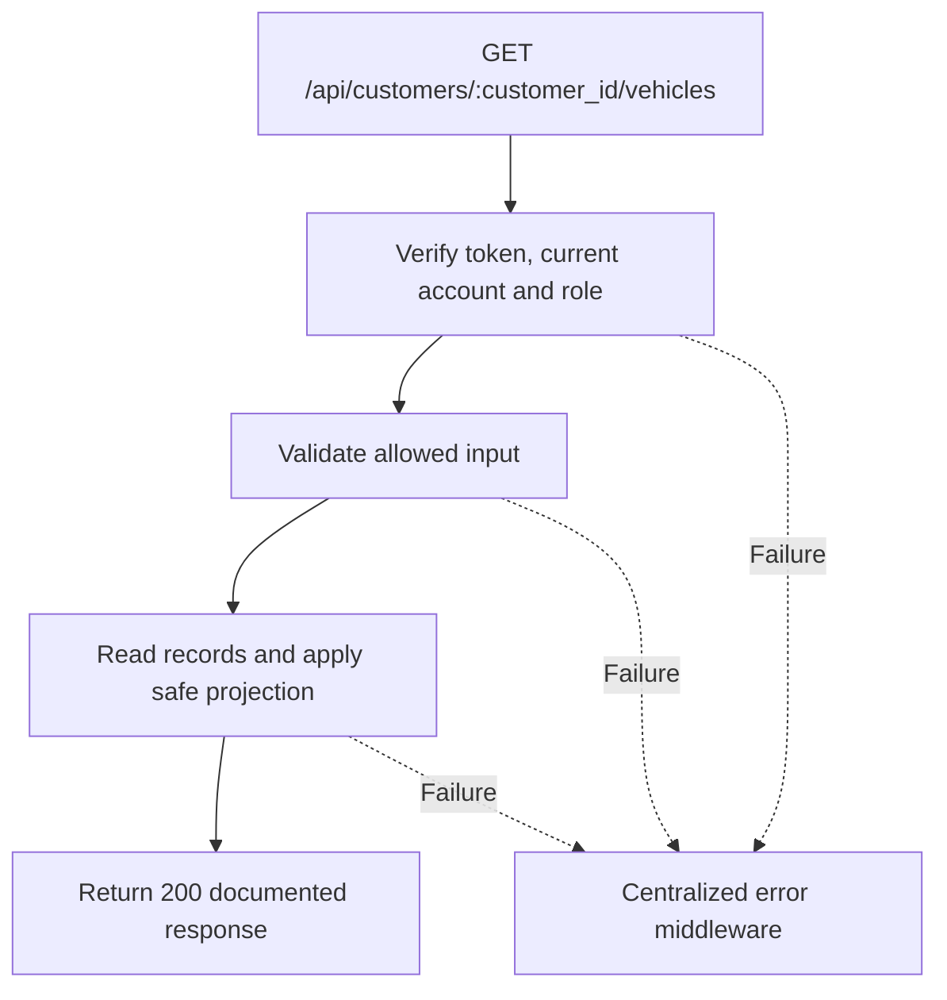

# Task BE-021: List a customer’s vehicles

**Endpoint**: `GET /api/customers/:customer_id/vehicles`

**Owner**: Member 2 · **Priority**: Must · **Requirement**: FR-VEH-01 / FR-ORD-01

**Dependencies**: BE-020. Dependencies describe contracts and integration order; use fixtures to begin development before the corresponding endpoint is complete.

## 1. API Documentation

- **Method**: `GET`
- **URL**: `/api/customers/:customer_id/vehicles`
- **Access**: Any active staff
- **Authentication**: `Authorization: Bearer <access_token>`
- **Content-Type**: `application/json`
- **Path parameters**: `customer_id` (positive integer)

### Request body

None. Do not send a JSON body.

### Success response (200)

```json
{
  "status": "success",
  "message": "List a customer’s vehicles successful",
  "data": {
    "customer_id": 12,
    "vehicles": [
      {
        "vehicle_id": 8,
        "customer_id": 12,
        "year": 2020,
        "make": "Toyota",
        "model": "Corolla",
        "type": "Sedan",
        "mileage": 65000,
        "plate": "AA-12345",
        "vin": "JTDBR32E720123456",
        "color": "White"
      }
    ]
  }
}
```

Examples use representative fixture records. Responses may have more/fewer array elements; fields and types are contractual. Nullable fields remain present as null. Where a task documents a restricted role projection, that projection replaces the general example for that role.

### Errors

- 400 Invalid input (unless this task specifies a different public-token rule)
- 401 Missing, invalid, expired or revoked access token
- 403 Inactive account or insufficient role
- 404 Customer not found
- 500 Unexpected server error

Shared error format (field errors apply to validation failures):

```json
{
  "status": "error",
  "message": "Validation failed",
  "data": {
    "errors": {
      "email": "Enter a valid email address"
    }
  }
}
```

Non-validation errors use `data: null`, except explicitly documented safe metadata. See [shared conventions](../CONVENTIONS.md).

## 2. Instructions

1. Define route and middleware in `backend/src/api/vehicles/routes/vehicle.route.js`.
2. Add `listCustomerVehiclesValidation` in `backend/src/api/vehicles/validations/vehicle.validation.js`.
3. Implement `listCustomerVehiclesController` in `backend/src/api/vehicles/controller/vehicle.controller.js`. Extract allowlisted inputs and verified actor context only.
4. Implement `listCustomerVehiclesService` in `backend/src/api/vehicles/service/vehicle.service.js`. Keep business rules and SQL out of controllers.
5. Share transactions, money/status helpers and notification adapter as described in foundation tasks; do not duplicate other modules’ logic.
6. On errors call `next(error)` from controller catches or use the shared async wrapper. Do not send competing error formats.

## 3. Logic & Git Instructions

### Logic steps

1. Verify customer exists, then return owned vehicles ordered vehicle_id DESC. This small lookup is intentionally unpaginated to support order selection.
2. An existing customer with no vehicles returns vehicles=[]. Missing customer returns 404.

### Git workflow

```bash
git checkout dev
git pull --ff-only origin dev
git checkout -b codex/be-021-list-customer-vehicles
# Implement and run task-specific checks
git add <changed-files>
git commit -m "[BE-021] List a customer’s vehicles"
git push -u origin codex/be-021-list-customer-vehicles
```

Open a PR into dev with requirement IDs, examples and test evidence. One teammate reviews. Coordinate shared route registration through Member 1; module files belong to their listed owner.

### PR checklist and acceptance criteria

- [ ] Successful request returns 200 and exactly the documented safe response shape.
- [ ] Missing/expired/revoked token returns401; inactive account and unauthorized role return403.
- [ ] Verify 404 Customer not found.
- [ ] Invalid/unknown input fields are rejected; no unexpected database changes occur on failure.
- [ ] GET has no data-changing side effects; list pagination/counts stay consistent.
- [ ] All errors go through centralized error middleware; no sensitive fields or stack traces escape.

## 4. Logic Diagram


